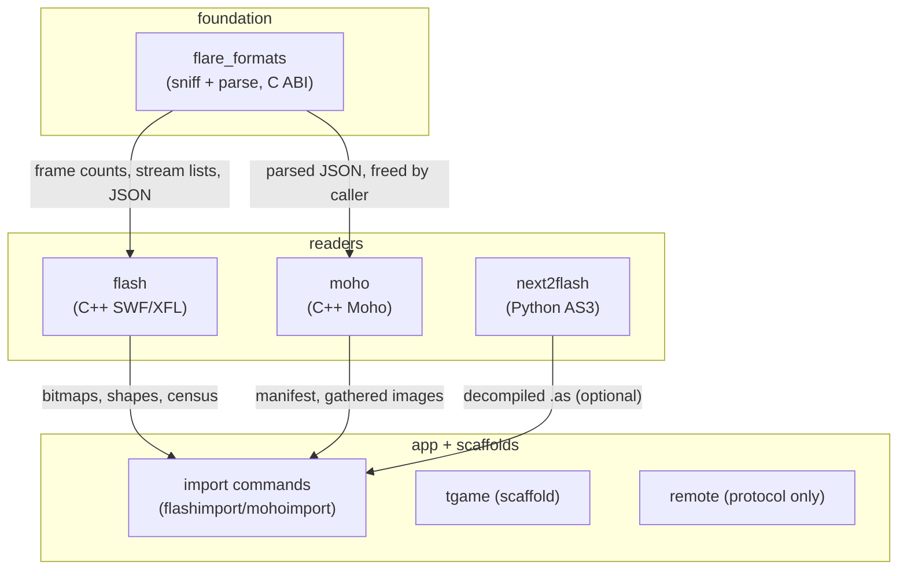

# Flare — Logic Atlas

> **Purpose.** One place to see the whole system's logic at once, so a reader (human or
> LLM) reasons about cross-cutting behavior instead of re-reading files piecemeal and
> guessing. Granularity is **subsystem → key functions (one line each) → invariants →
> state → coupling** — not a line-by-line mirror.

**Current state.** Flare is a C++/Qt desktop 2D animation studio (an OpenToonz/Tahoma2D
fork reworked toward an Adobe Animate workflow) with a Rust backend growing beside it:
`flare/sources/common/flash` and the other `common/*/rust` modules own content
sniffing and Flash/Moho parsing behind a C ABI declared in
`flare/sources/include/flare_formats.h`, `flare/sources/common/flash` and
`flare/sources/common/moho` own the C++ readers, and the top-level app wires them into
import commands served from `flare/sources/flare`.

> **Rust layout rule.** Rust never gets a sidecar tree. Each ported module lives at
> `flare/sources/common/<subsystem>/rust/<name>.rs`, beside the C++ it ports, and is
> registered in the `#[path]` list at the crate root `flare/sources/rust/flare_formats.rs`.
> A missing or misspelled `#[path]` is a compile error, so the crate root is the single
> inventory of what has been ported.

> Snapshot: Flare @ b213689c4 (remote crate C ABI + tests, all suites pass)
> listing port): Rust format sniffing over a C ABI, C++ SWF/XFL/Moho readers, an
> optional Python AS3 sidecar, a scaffolded game engine, and a P2P protocol with tests.

> **How to read this atlas.** Each `## ` heading is one subsystem, ordered by dependency
> (foundation → … → top-level app). Start at **L0** for the shape and its **SPINE** block
> for the one per-import flow everything serves, then drop into a subsystem's
> section for its function inventory and the invariants that must hold. **Cross-cutting
> flows** is where the dangerous bugs live. To locate a symbol, search the whole file for
> its name: each is on one line with its invariant. Trust the function *names* and
> *invariants* over line numbers — positions drift, contracts don't.

> **Maintenance.** Regenerate a subsystem's `## ` section when you materially change it, and
> keep the Snapshot commit above current. `scripts/atlas_check.py` (run at commit time)
> resolves the atlas's own file, symbol, and constant claims against the tree and fails on a
> broken one, so the map stays honest.

> **Scope.** Flare-owned subsystems: the Rust format crates, the Flash/Moho readers, the
> game-engine scaffold, the AS3 sidecar, and the remote protocol. The inherited
> OpenToonz/Tahoma2D core (`tnzcore`, `tnzbase`, `flarelib`, the app itself) is covered
> only where Flare's code couples to it. Build output, vendored third-party code, and
> translations are out of scope.

---

## Contents

- [L0 — the whole program at a glance](#l0-the-whole-program-at-a-glance)
- [flare_formats — Rust content sniffing and format parsing](#flare_formats--rust-content-sniffing-and-format-parsing)
- [flash — C++ SWF/XFL readers](#flash--c-swfxxfl-readers)
- [moho — Moho project reader](#moho--moho-project-reader)
- [tgame — game-engine scaffold](#tgame--game-engine-scaffold)
- [next2flash — optional AS3 sidecar](#next2flash--optional-as3-sidecar)
- [remote — P2P remote-control protocol](#remote--p2p-remote-control-protocol)
- [flare_remote — Rust remote-protocol crate](#flare_remote--rust-remote-protocol-crate)
- [Cross-cutting flows (where the bugs live)](#cross-cutting-flows-where-the-bugs-live)

---

## L0 — the whole program at a glance

**Namespace:** n/a  **Dir:** `.`  **Deps:** top of the graph  **Entry points:** `flare/sources/flare/flashimport.cpp`, `flare/sources/flare/mohoimport.cpp`, `tests/run_all.py`.

**Job:** Flare opens other programs' files — SWF, FLA/XFL, Moho — detects what they are
by content, parses them with Rust or C++ readers behind narrow interfaces, and hands
the result to the inherited animation studio core. Everything below feeds that flow.

**Boot (once, before the loop):**
`parse args → load env → mount stuff dir → load room profile → open main window`.

**The spine (per-import, the load-bearing flow):**
`file bytes → flare_detect_format → reader for the detected Format → parsed
structures → import command (flashimport.cpp / mohoimport.cpp) → scene levels`.

**Invariants:**
- Detection is by content, never by extension — a SWF named `.fla` still opens.
- Every subsystem feeds a stage of the spine or edits what it renders; nothing runs outside these flows.
- Rust-allocated strings cross the C ABI exactly once and are freed by the caller with `flare_moho_free`.

**State:** the file on disk is authoritative; parsed structures are derived and discarded after import.

---

## flare_formats — Rust content sniffing and format parsing

**Namespace:** crate root  **Dir:** modules sit beside the C++ they port — `flare/sources/common/flash/`, `flare/sources/common/moho/`, `flare/sources/common/tsystem/`, `flare/sources/common/tapptools/`; crate root `flare/sources/rust/flare_formats.rs`, manifest `flare/sources/Cargo.toml`, public header `flare/sources/include/flare_formats.h`  **Deps:** none (leaf)  **Entry points:** `flare_formats.rs`, `flare_formats.h`, `Cargo.toml`.

**Job:** Decide what a file is from its bytes and answer small structural questions about
it, exposing everything through `extern "C"` functions declared in `flare_formats.h`.
The module paths are `#[path]`-mapped from the crate root precisely so the tree keeps
matching OpenToonz/Tahoma as the rewrite proceeds — no `rust/` sidecar tree.

**Key functions/types:**
- `detect` (`flare_formats.rs`) — content sniffing: SWF magic, CFBF signature, PK+DOMDocument, bare `DOMDocument`.
- `flare_detect_format` (`flare_formats.rs`) — the C ABI for `detect`; returns the `Format` discriminant.
- `flare_flash_frame_count` (`flare_formats.rs`) — timeline length of SWF/FLA/XFL by path; -1 unknown.
- `frame_count` (`common/flash/framecount.rs`) — the logic behind it, dispatching on `detect`.
- `cfbf_streams` (`common/flash/framecount.rs`) — CFBF directory walk yielding (name, size) pairs.
- `flare_cfbf_streams` (`flare_formats.rs`) — the C ABI for it; NUL-terminated text, freed with `flare_moho_free`.
- `unzip_any` (`common/moho/moho.rs`) — first ZIP entry whose name is in a caller-supplied list.
- `swf_frames`, `swf_header`, `cfbf_header`, `xfl_dom_info` (`flare_formats.rs`) — header primitives the above compose.

**Invariants:**
- `detect` reads magic bytes only, never the extension — the content-over-extension contract lives here.
- Every `*mut c_char` a `flare_*` function returns is owned by the caller and freed with `flare_moho_free`; a NULL return always means "not this format / error", never partial data.
- `cfbf_streams` walks the header DIFAT only, so files past ~7MB at 512-byte sectors are out of reach by construction.
- `kTwipsPerPixel` is 20.0 — one twip is 1/20th of a pixel per the SWF spec, and shape coordinates divide by it.

**State:** stateless; no globals, no handles. All functions are pure over their inputs.

**Coupling:** consumed by the C++ readers and import commands through `flare_formats.h`. Consumes nothing.

---

## flash — C++ SWF/XFL readers

**Namespace:** `FlashAssets`, `XFL`  **Dir:** `flare/sources/common/flash`  **Deps:** `flare_formats` (sniffing/frame counts), Qt XML  **Entry points:** `SWFAssets.h`, `XFLReader.h`, `XFLShape.h`, `FSWFStream.h`, `As3Bridge.h`, `tflash.h`, `ZipArchive.h`.

**Job:** Parse SWF tag streams and XFL documents into bitmaps, shapes, and a content
census the import command can report on. Handles the containers Rust only sniffs.

**Key functions/types:**
- `cfbf.rs` (Rust) — legacy-FLA CFBF stream reader + image carver; C ABI `flare_cfbf_open/count/stream/bitmaps/free`.
- `extractSwfShapes` (`SWFAssets.h`) — shapes out of an SWF tag stream.
- `extractLegacyFlaBitmaps` (`SWFAssets.h`) — bitmap carving from OLE2/CFBF binary FLAs.
- `Reader` (`XFLReader.h`) — `read`, `readFromZip`, `readFromDirectory`, `parseDOMDocument`, `parseSymbol`.
- `decodeEdges`, `decodeShapeXml`, `toSvgPath`, `toSvgDocument` (`XFLShape.h`) — edge-string geometry to SVG.
- `decompile`, `patchStrings`, `isAvailable` (`As3Bridge.h`) — the optional AS3 sidecar client; every entry degrades to "unavailable", never throws.
- `TFlash` (`tflash.h`) — render-data wrapper; its copy operations are declared private and unimplemented (pre-C++11 `= delete` idiom), so it is move-only by construction.

**Invariants:**
- A number in opcode position is rejected, never read as an opcode with coordinate 0 — the tokenizer tags numbers as `Op::Number` and the arity check enforces it.
- `kTwipsPerPixel` is 20.0 here too; both copies divide shape coordinates by it and must agree with the spec value.
- `As3Bridge` degrades: no Python or no helper means AS3 menu entries grey out while FLA/XFL/SWF import, bitmaps, and timeline keep working.
- ZIP extraction repairs a wrong end-of-central-directory record before unpacking; real `.fla`/`.swc` files carry stale trailers.

**State:** `Reader` holds the parsed `Document` (timelines, bitmaps, census); `TFlash` holds render tables. Nothing global.

**Coupling:** consumes `flare_formats` (detection, frame counts, CFBF stream lists) and the Python sidecar (AS3 only). Consumed by the import commands.

---

## moho — Moho project reader

**Namespace:** `Moho`  **Dir:** `flare/sources/common/moho`  **Deps:** `flare_formats` (ZIP entry extraction), Qt JSON  **Entry points:** `MohoReader.h`, `MohoPlan.h`.

**Job:** Read a Moho/Lost Marble project structurally — layers, bones, switch layers,
keyframe tracks, referenced images — and turn it into an xsheet layout plan. Rendering
the rig is deliberately out of scope.

**Key functions/types:**
- `read` (`MohoReader.h`) — parse a `.moho`/`.anime` ZIP or bare document into a `Document`; false plus `doc.error` on failure, legacy `.anme` recognised not parsed.
- `writeManifest` (`MohoReader.h`) — rig structure to `moho_manifest.json`, existing images copied beside it; returns files written.
- `makePlan` (`MohoPlan.h`) — flatten layers to `ColumnPlan` columns in draw order.
- `switchChildAt` (`MohoPlan.h`) — active switch child at a frame: last key at or before it (step keys).

**Invariants:**
- Every field is read with a default — generations 1021–1045 drop fields (`doc_uuid`, `action_refs`, bezier weights, `modified_date`), and assuming presence crashes on older files.
- Frame 0 is the rest pose: the first switch key *is* the rest pose, reported as `childAtRest` alongside `childAtEnd` rather than picking one silently.
- Bitmaps live outside the container (sibling `images/` folder), so a bare `.moho` is incomplete by construction; the reader reports found-vs-missing counts.
- Temp extraction is scoped (`ScopedTempDir`, destructor-silent): a failed cleanup never throws out of a destructor.

**State:** `Document` owns layers, bones, switches, census; `Plan` owns columns and row visibility. Nothing global.

**Coupling:** consumes `unzip_any` from `flare_formats` for container entries. Consumed by the Moho import command.

---

## tgame — game-engine scaffold

**Namespace:** `TGame::`  **Dir:** `flare/sources/common/tgame`  **Deps:** none yet (not wired to the UI)  **Entry points:** `GameEngine.h`, `GameEngine.cpp`.

**Job:** Entity-component-system game engine for Flash-style game creation: entities with
a 64-bit component mask, pure-data components, systems with priorities, scenes owning
both, plus asset/input/physics/audio/camera/particle/UI systems. Currently scaffolded,
not reachable from the application UI.

**Key functions/types:**
- `Entity` (`GameEngine.h`) — id plus component mask; `addComponent`/`getComponent`/`removeComponent` maintain the mask.
- `Component` (`GameEngine.h`) — pure data, no logic; `clone` for copying.
- `System` (`GameEngine.h`) — `init`/`update`/`render` over entities matching `requiredMask`, ordered by `priority`.
- `Scene` (`GameEngine.h`) — owns entities and systems; JSON `save`/`load`.
- `TransformComponent`, `SpriteComponent`, `PhysicsBodyComponent`, `ScriptComponent`, `AudioComponent`, `CameraComponent`, `UIComponent`, `ParticleComponent` (`GameEngine.h`) — the eight component types.

**Invariants:**
- Components hold data only; all logic lives in systems — an entity query is a mask match, never a type switch in game code.
- Up to 64 component types fit the mask; exceeding it silently collides, so the count is load-bearing.

**State:** `Scene` owns the entity map and system list; systems hold no cross-entity state between updates.

**Coupling:** none yet — that is the gap: no UI wiring, no asset pipeline into it.

---

## next2flash — optional AS3 sidecar

**Namespace:** n/a (Python)  **Dir:** `tools/flash/next2flash`  **Deps:** none (vendored `as3_decompiler`, MIT)  **Entry points:** `flare_as3_bridge.py`, `README.md`.

**Job:** Decompile AS3 from ABC blocks, rewrite constant strings, and compile back via the
Flex SDK — through one JSON object on stdout per invocation, the same probing model as
FFmpeg detection.

**Key functions/types:**
- `cmd_status`, `cmd_capabilities`, `cmd_decompile`, `cmd_compile`, `cmd_patch` (`flare_as3_bridge.py`) — the five commands; `compile` needs an undiscovered Flex SDK and says where it looked.
- `find_flex_sdk`, `find_mxmlc` (`flare_as3_bridge.py`) — SDK discovery order: env override, SDK variables, install root, well-known locations, PATH.
- `VENDOR_DIR`, `_vendor_available` (`flare_as3_bridge.py`) — the vendored package gate; missing or unimportable degrades every command to "unavailable".

**Invariants:**
- One JSON object on stdout per invocation; diagnostics go to stderr so stdout stays machine-readable.
- `status` keeps a fixed two-key schema (`available`, `version`); capability reporting lives in `capabilities`, never in `status`.
- `decompile` isolates DoABC blocks into per-block subdirectories; class names can collide across blocks and sharing one directory would silently overwrite.
- ABC string index 0 is the "any" sentinel and is never rewritten by `patch`.
- The bridge never raises to its caller; every failure is a JSON error object.

**State:** stateless per invocation. The C++ client probes once and caches.

**Coupling:** consumed only by `As3Bridge`; the vendor package's `LICENSE` is shipped beside it and the top-level `LICENSE.txt` points at it.

---

## remote — P2P remote-control protocol

**Namespace:** `flare_remote`  **Dir:** `flare/sources/remote`  **Deps:** `flare_remote` (Rust crate, tested)  **Entry points:** `remoteprotocol.h`, `remotetransport.h`, `remotedialog.h`.

**Job:** The wire protocol for serverless device-to-device remote control: message framing
(`Msg`), session state (`Session`), and the transport interface. The Rust crate now
implements the transport (UDP hole-punch with a 6-char pairing code) and exposes a
C ABI so the C++ dialog can drive it without reimplementing the protocol.

**Key functions/types:**
- `Msg` (`remoteprotocol.h`) — the framed message type.
- `Session` (`remoteprotocol.h`) — session state machine.

**Invariants:**
- Protocol first, transport later: nothing in this directory opens a socket, so no half-wired networking can run.

**State:** `Session` holds handshake and channel state.

**Coupling:** mirrors the `flare_remote` Rust crate; the two must agree on framing or nothing interoperates.

---

## flare_remote — Rust remote-protocol crate

**Namespace:** crate root  **Dir:** `flare/sources/remote/rust`  **Deps:** none (leaf)  **Entry points:** `src/lib.rs`, `Cargo.toml`.

**Job:** The Rust side of the remote-control protocol. Implements UDP hole-punch,
pairing-code exchange, message framing, and a C ABI (`flare_remote_host`,
`flare_remote_join`, `flare_remote_send`, `flare_remote_poll`, `flare_remote_close`,
`flare_remote_port`). Unit-tested (4 tests: protocol round-trip, bad code rejection,
and C ABI shape checks).

**Invariants:**
- Framing changes land in both the crate and `remoteprotocol.h` in one commit — a silent split bricks interop with no compile error on either side.
- The C ABI never panics; NULL handles and invalid arguments return error codes.

**State:** stateless helpers plus session structs.

**Coupling:** consumed by the C++ remote dialog (via `remotetransport.h`); mirrors the C++ protocol headers.

---

## Cross-cutting flows (where the bugs live)

**Namespace:** n/a  **Dir:** `flare/sources/flare/flashimport.cpp` wires readers, Rust, and sidecar  **Deps:** this section is the wiring between subsystems and owns no code of its own.  **Entry points:** `flashimport.cpp`, `mohoimport.cpp`, `tests/run_all.py`.

These flows span subsystems: the class of bug a single-file read misses, because both ends of a coupling have to agree and they sit in different files.

**Import spine.** file bytes → `flare_detect_format` → reader for the `Format` → parsed structures → `flashimport.cpp`/`mohoimport.cpp` → scene levels. Risky edge: **the Rust/C++ header mirror** — `flare_formats.h` must declare exactly what `lib.rs` exports; a drifted signature links or, worse, misreads memory. Both change in one commit.

**Rust string ownership.** Rust allocates → C++ uses → C++ frees with `flare_moho_free`. Risky edge: **the single free** — freeing twice or never freeing is invisible to the compiler on both sides.

**AS3 availability chain.** Python helper presence → `As3Bridge::isAvailable` → menu greying. Risky edge: **the dev-build path walk** — the helper sits four levels above a dev `Flare.exe`, and the candidate list plus the bounded upward walk must keep covering both dev and bundle layouts or SWF imports silently lose ActionScript.

**Moho asset gathering.** `referencedImages` → sibling-folder lookup → `imagesFound`/`imagesMissing` → manifest. Risky edge: **the missing-artwork message** — a bare `.moho` is incomplete by format design, and silence here reads as a Flare bug.

**Layout profiles.** room `.ini` files → `validate` → room list. Risky edge: **the pane/hierarchy index contract** — every `pane_K` index must appear in its `hierarchy` list; the flipaclip profile test pins this.

**Rust module inventory.** `flare_formats.rs` `#[path]` list → the `.rs` files on disk. Risky edge: **the un-registered module** — a ported file that is not in the `#[path]` list compiles fine and is never built, so the port looks done and ships as dead code; the file's absence from the list is a compile error, which is the only guard.

**Atlas self-check.** `LOGIC-ATLAS.md` claims → the tree. Risky edge: **the honest citation** — every path, symbol, and pinned constant is resolved live by `scripts/atlas_check.py` at commit time (see `.claude`/hooks), so a stale name fails the commit rather than misleading the next reader.

1. **Test spine.** `tests/run_all.py` → pytest suites + `tests/run_rust.py` (cargo) + `tests/native/run_tests.py` → native binaries. Risky edges:
   - **The Qt discovery** — `run_tests.py` locates Qt itself for both CMake and PATH; an unset `QT_BIN` must not fail the run.
   - **The staged-DLL rule** — the fresh `tnzcore.dll` is staged beside the test binaries, because Windows resolves imports from the exe directory first and a stale copy dies with `0xC0000135`/`0xC0000139` before `main`.
   - **The local-source default** — `FLASH_LOCAL_SRC=ON` compiles checked-out sources into the tests; `--no-local-src` exercises the export/ABI path instead and needs freshly built DLLs.
   - **The skip is not a pass** — `run_rust.py` exits 0 with a SKIP notice when cargo is missing; it never prints a pass count it did not measure.
