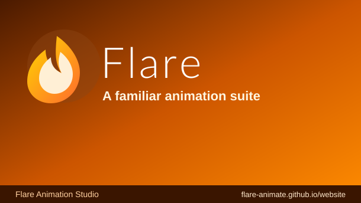
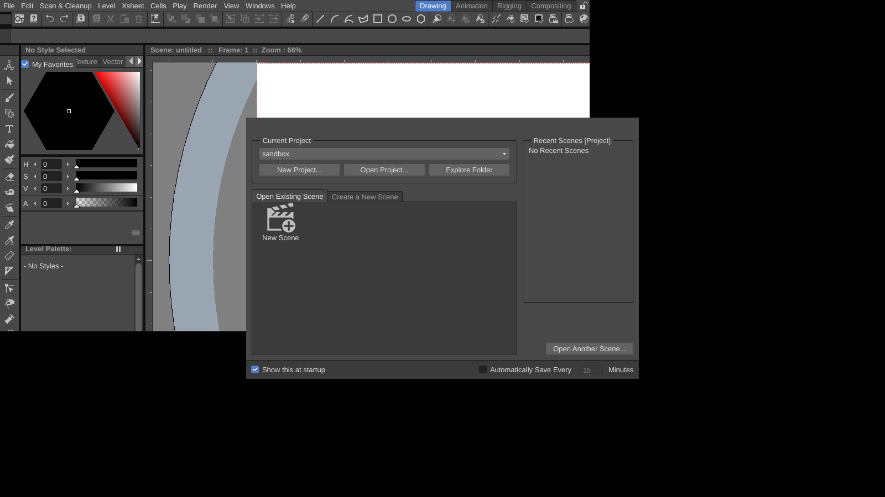

<div align="center">

# Flare



**Free, open-source animation suite with continuity for Adobe Animate and Flash users.**

[](https://discord.com/invite/JpeScW8Awa)
[](https://github.com/Flare-Animate/Flare/releases/tag/nightly)
[](https://github.com/Flare-Animate/Flare/issues)


[Website](https://flare-animate.github.io/website/) · [Discord](https://discord.com/invite/JpeScW8Awa) · [Download](https://github.com/Flare-Animate/Flare/releases/tag/nightly) · [Issues](https://github.com/Flare-Animate/Flare/issues) · [日本語](./doc/README_ja.md) · [简体中文](./doc/README_chs.md)

</div>



> **Early alpha.** Expect bugs and incomplete Flash/Animate import fidelity. Back up your work.

## Features

- Animate-style workspace with Drawing / Animation / Rigging / Compositing rooms (other room layouts under **Preferences > Interface > Rooms**).
- Vector and raster drawing, xsheet/timeline, plastic rigging, FX schematic, motion tracking, script console (inherited).
- Flash/Animate import: `.fla`, `.xfl`, `.swf`, `.swc`, `.flv`/`.f4v`, `.as`, legacy binary `.fla`, AIR/ZXP/MXP packages. Fidelity is partial; vector shapes are not yet converted to levels ([STATUS.md](docs/STATUS.md), [FLASH_SUPPORT.md](docs/FLASH_SUPPORT.md)).
- Moho project reading: structure, rig and asset manifest, no rendering atm ([MOHO_SUPPORT.md](docs/MOHO_SUPPORT.md)).

Full format table, repository layout, tests and roadmap: [docs/FEATURES.md](docs/FEATURES.md).

## Download

Nightly builds: **[latest nightly release](https://github.com/Flare-Animate/Flare/releases/tag/nightly)**

| Platform | Asset |
|----------|-------|
| Windows 10/11 x64 | `Flare-Windows-Portable-nightly.zip` |
| Linux x86_64 (glibc 2.35+) | `Flare-x86_64.AppImage` |
| macOS 13+ | `Flare.dmg` |

Optional: FFmpeg on `PATH` for `.swf`/`.flv`/`.f4v` playback. macOS and Linux first-launch notes: [docs/FEATURES.md](docs/FEATURES.md#install-notes).

## Build

```sh
cmake -S flare/sources -B build -G Ninja -DCMAKE_BUILD_TYPE=Release
cmake --build build -j2   # builds are memory-heavy; use -j1 below 4 GB RAM
```

Guides: [Windows](docs/how_to_build_win.md) · [macOS](docs/how_to_build_macosx.md) · [Linux](docs/how_to_build_linux.md) · [BSD](docs/how_to_build_bsd.md) · [local builds](docs/LOCAL_BUILD.md)

## Rust rewrite status

The C++ code is being ported to Rust incrementally: 329 tracked `.rs` files vs 1107 remaining `.c`/`.cpp` files under `flare/sources` (counted on `Rust-Rewrite`).
Details: [RUST_REWRITE.md](docs/RUST_REWRITE.md) · [PORTING.md](docs/PORTING.md) · [REWRITE_BACKLOG.md](docs/REWRITE_BACKLOG.md)

## Contributing and community

See [CONTRIBUTING.md](CONTRIBUTING.md). [Discord](https://discord.com/invite/JpeScW8Awa) · [Website](https://flare-animate.github.io/website/) · [Discussions](https://github.com/orgs/Flare-Animate/discussions) · [Issues](https://github.com/Flare-Animate/Flare/issues)

## License

Modified BSD, see [LICENSE.txt](LICENSE.txt). Third-party components keep their own licenses.

Based on OpenToonz / Tahoma2D (BSD-3), see [THIRD-PARTY-NOTICES.md](flare/sources/THIRD-PARTY-NOTICES.md) and [LICENSE.txt](LICENSE.txt).
