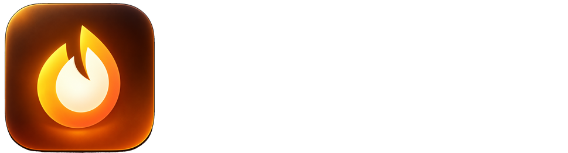

**English** | [Deutsch](docs/translations/README.de.md) | [Español](docs/translations/README.es.md) | [Français](docs/translations/README.fr.md) | [Português (Brasil)](docs/translations/README.pt-BR.md) | [日本語](docs/translations/README.ja.md) | [한국어](docs/translations/README.ko.md) | [简体中文](docs/translations/README.zh-CN.md)

  

# Flare

A free, open-source animation tool in the spirit of Adobe Animate, written in Rust. Built for Windows, macOS and Linux.

> **Early alpha.** Expect bugs and incomplete Flash/Animate import fidelity. Back up your work.

<!-- A screenshot of the editor goes here: assets/repository/flare-app.png -->

### Features

- Draw with the tools Animate has, plus an extended library of tools such as Ruler (measures distance and angle) and Mirror. 
- Lay out frames and layers on a timeline, with folders, masks, motion guides, motion and shape tweens with Ease, onion skin and a camera layer.
- Symbols (Graphic, Movie Clip and Button) in a library, placed as instances on the stage.
- Play the animation with sound, and Test Movie runs the published SWF in Ruffle.
- Open and save `.flare` projects. Import and export Animate's XFL and .fla, and open Flash movies (`.swf`) as editable projects
- Export PNG, GIF and MP4, and publish a SWF or an HTML5 Canvas page.
- A command line interface (`flare`) to create, edit, export and publish projects from scripts.

### Downloads

There will be downloads for Windows, macOS and Linux, but there are none yet. We will add them here once packaging is done. Until then, build from source (below).

### Build and run

Rust is pinned in `rust-toolchain.toml`. Ruffle is a git submodule, so clone with submodules:

    git clone --recurse-submodules https://github.com/Flare-Animate/Flare.git
    cd Flare
    cargo run --release -p flare-desktop

On Linux install the libraries listed in [CONTRIBUTING.md](CONTRIBUTING.md).

[docs/BUILDING.md](docs/BUILDING.md) has the steps for each platform: Linux, Windows, macOS, the browser build and Android.

### Command line

    flare new project.flare --width 1280 --height 720
    flare draw-rect project.flare --rect 100 100 300 200 --color FF6600
    flare export project.flare frame.png
    flare export project.flare loop.gif --format gif
    flare publish-html5 project.flare page.html
    flare --help

### Why Flare exists

Adobe [announced](https://community.adobe.com/announcements-539/adobe-animate-end-of-life-and-support-timeline-1548220) the end of life of Animate and later [reversed course](https://community.adobe.com/announcements-539/update-on-the-status-of-adobe-animate-1548459). Though they reversed course, this shows just how volatile the animation industry is, and displays how much of a monopoly certain companies have on it. Animators were thrown into legitimate panic. People's careers should not depend on one company's decision to keep selling a product. 

Flare began as a playground for making animation easier to learn, was later open-sourced, and grew from there.

### Roadmap

The next things, most important first. Most of it is shown dimmed in the interface. [docs/ROADMAP.md](docs/ROADMAP.md) repeats this list and goes on to everything of lower priority.

- Merge drawing: Flash's planar-map shapes, where overlapping shapes cut and merge each other (today shapes are separate objects)
- Drawing quality: brush dynamics, and tracing a bitmap into vector shapes
- SWF that keeps more of the document: buttons with their states, shape tweens as morphs, masks of several shapes and sounds inside symbols
- A Motion Editor: per-property graphs and custom ease curves for tweens
- Importing artwork from SVG and Photoshop files
- Bones and inverse kinematics (the Bone and Bind tools)
- Editable keyboard shortcuts

Also planned, at lower priority: ActionScript and a script editor (ActionScript in an imported file is kept as data and never run), shape hints and more than one scene, the rest of Animate's tools, custom themes, a fully rearrangeable toolbar and a released web build.

### Documentation

[docs/README.md](docs/README.md) explains how Flare is built. 

Contributors should look at [CONTRIBUTING.md](CONTRIBUTING.md), [AGENTS.md](AGENTS.md), [SECURITY.md](SECURITY.md) and [CHANGELOG.md](CHANGELOG.md).

### Community

[Discord](https://discord.com/invite/JpeScW8Awa) · [Website](https://flare-animate.github.io/website/) · [Discussions](https://github.com/orgs/Flare-Animate/discussions) · [Issues](https://github.com/Flare-Animate/Flare/issues)

### License

BSD 3-Clause. See [LICENSE](LICENSE).

## What is Flare?

Flare is a (Work In Progress) Animation Suite, designed to make the transition from software like Adobe Animate, Adobe/Macromedia Flash and Moho easier for Artists and Animators. We implement support for all formats used by those tools, and redesign the UI to have a more simplistic and familiar layout.

It is being rewritten in Rust, based predominantly on OpenToonz and Tahoma2D, with many features merged in from AnimationCraft and Next2Flash.

### Format support

- Flash/Animate: .fla, .xfl, .swf, .swc, .flv/.f4v, .as, legacy binary .fla, AIR/ZXP/MXP packages
- Moho projects (.moho, .anime, .mohoproj, .animeproj) and BVH motion: layers, bones, keyframes, switch cells and vector art import as editable projects (images and sound are listed, not placed)
- OpenToonz formats: .tnz scenes and .pli vector levels import (frame rate, camera, xsheet columns, strokes, palette colours); .tlv raster levels and .tzu are planned
