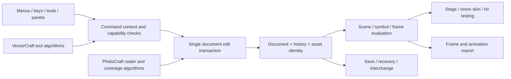

# Flash CC 2015 → Flare: gaps and implementation pairings

Reviewed 2026-10-11. Target: the user's Flash Professional CC 2015, build
15.0.0.173. Delivery target: **Flare's native Rust Studio**, not the separate Qt
executable. This is the current work list for closing functional gaps.

Every entry pairs a missing Flash workflow with existing implementation code.
ArtCraft supplies reusable techniques and code; its Illustrator/Photoshop feature
sets do not expand this target. A visible control or an unused engine method does
not count as a working Flare feature.

## Evidence and status rules

- **Partial**: a portion is reachable in Studio; remaining behaviors are listed.
- **Unwired**: source exists in the pinned engine or a sibling app, but Studio
  does not expose the workflow. Reuse still needs integration and behavior tests.
- **Missing**: no matching implementation found in the inspected paths. This is
  scoped evidence, not proof that no code exists anywhere in the inherited tree.
- **Verified slice**: a named workflow has an executable regression test. It does
  not certify the entire module or exact Adobe parity.

Primary baseline: [Adobe's Flash CC 2015 reference](https://helpx.adobe.com/archive/kr/flash/cc/2015/flash_reference.pdf).
The [English archive under Animate CC 2015](https://helpx.adobe.com/archive/en/animate/cc/2015/animate_reference.pdf)
is dated February 2016 inside the PDF; it is a supplementary behavioral reference,
not evidence that a later feature belongs in build 15.0.0.173. Frame insertion and
selection appear on PDF pages 275–276 in the Flash archive and 209–211 in the
English archive. User-supplied screenshots establish the workspace target.

Implementation snapshots inspected:

| Source | Revision | What it establishes |
|---|---|---|
| Flare | `cfae5de41` + current working tree | Reachable Studio commands, panels, document validation and rendering |
| AnimationCraft | `e3aadad1c9cc6451f39746226123fd1021fd889a` | ac-render is pinned; ac-core is copied locally with a Cargo patch and backward-compatible layer row height; see `flare/sources/flare/rust/core/ORIGIN.md` |
| PhotoCraft | `56b192453e04994666d6532efb43a03d4f1d494f` | Raster/vector algorithms and transaction patterns |
| VectorCraft | `2ac3ba2b866ad9d34b2252dd8024f73e34f4b2b8` | Vector gesture, path editing, snapping and boolean implementations |

The older [absorption assessment](ANIMATIONCRAFT_ABSORPTION.md) evaluated the Qt
application. Its “skip Editor/model/renderer/UI” decisions do not describe the
user-selected native Rust architecture. The vendored
[AnimationCraft audit](../doc/ANIMATE-GAP-ANALYSIS.md) targets Animate 24.x and
reports upstream coverage; its percentages must not be presented as Flare coverage.
No percentage is assigned here until individual workflows have evidence.

## Completion ledger and delivery scope

The user authorized phased completion of the full gap backlog on 2026-10-11,
without dropping functionality. The phase register below owns the sequence;
the detailed M00-M13 table remains the functional inventory. Newly discovered
gaps must be added to a phase, never silently excluded to close it. A phase
stays open until its checklist and relevant shared contracts are verified.

| Phase | Retained scope | Status / exit workflow |
|---|---|---|
| P1 Timeline and layer editing | Cell/span/range selection, frame insert/remove/clear/key conversion, clipboard, move/copy/reverse/bake, duration editing, frame labels; layer add/rename/delete/duplicate/reorder, folders/nesting/collapse, visibility/locking | **In progress**. Edit a multi-layer animation using menus, shortcuts and gestures; verify one undo per transaction, locked destinations, symbol context, save/reopen and unchanged evaluation outside the edited range |
| P2 Timeline composition and navigation | Scene lifecycle/order, masks, guides/motion guides, layer outline/color controls, onion skin/ranges, edit multiple frames, playback ranges/looping; exact frame-label types/anchors and context-sensitive tween rules | **Open**. Same scene/symbol/frame evaluation in stage, hit testing and export; scene operations preserve identity and history |
| P3 Selection and transforms | Object/point selection, marquee/lasso, object clipboard/duplicate, groups, alignment/distribution, registration/pivot, scale/rotate/skew/flip, snapping/grid/ruler guides and transform inspectors | **Open**. Select, transform and organize objects with cancel/undo, save/reopen and symbol use |
| P4 Vector drawing and appearance | Pen/pencil/vector brush, primitives, anchor/handle editing, merge/object drawing, shape operations, fill/stroke styles, gradients, swatches, eyedropper, bucket/ink, erase, reshape/smooth/straighten/optimize | **Open**. Draw, overlap, reshape and paint editable artwork; preserve winding, fills/strokes and animation through persistence/export |
| P5 Symbols and animation | Library organization/place/swap/rename/duplicate, Graphic/MovieClip/Button authoring and instance controls, nesting/edit-in-place, loop/first-frame, classic/shape/motion tweening, easing/motion editing, shape hints, paths, bone/IK authoring, supported effects/blends/color transforms | **Open**. Reused instances and nested animations update consistently; author and export tested animation fixtures |
| P6 Text and media | Static/dynamic/input text, formatting/fonts/shaping, bitmap import/place/edit/trace, linked assets, sound import/sync/envelopes, video import/playback and timeline integration | **Open**. Create/import, edit, reuse, save/reopen and preview/export with explicit runtime dependencies for dynamic content |
| P7 Interchange, export and publishing | Native project integrity, editable Flash/XFL/FLA/SWF conversion where applicable, asset interchange, PNG sequences/GIF/SVG/video, target profiles, SWF/HTML5/AIR publishing, frame ranges/transparency/jobs/cancellation/diagnostics | **Open**. Round-trip supported fixtures and publish outputs that match authoring; unsupported/lossy cases remain listed |
| P8 Scripting and runtime | Actions authoring, authoring commands/extensions, ActionScript/runtime support, sandboxed playback, test movie/debugging and target integration | **Open**. Execute and debug published/test content under a defined target contract; JS/decompilation alone does not close AS runtime gaps |
| P9 Complete application workflows | Multiple documents/recovery/recent files, workspace docking/presets, shortcut customization, preferences, keyboard/focus/accessibility, localization/font/RTL readiness, packaging/performance/error recovery | **Open, cross-cutting work starts in P1**. Daily-use project workflows survive restart, language/theme changes, errors and keyboard-only operation |

**Sequence confirmed by the user:** retain these nine phases. Flex SDK integration,
its Rust replacement work, and SWF publishing remain in P7; runtime execution,
Test Movie and debugging remain in P8. Do not move an SWF milestone after P1.

P7's SDK inventory must explicitly cover compiler/linker and configuration tooling,
AS3/MXML inputs, SWC/library resolution, framework dependencies, diagnostics, and
authored timeline/assets to SWF. A compiler command wrapper alone does not complete
the requested Rust replacement: port and compare each subsystem against reference
fixtures while tracking all remaining SDK compatibility. P8 must separately run
existing and newly published SWFs with defined runtime/API coverage, output and
debugging. Compilation is not proof of playback or editable SWF import.

The inventory is an audited starting point, not a claim that every CC 2015 command
has already been enumerated. Before closing each phase, reconcile its relevant
Flash manual chapters, menus/dialogs and documented workflows against the register;
unaccounted features become explicit open entries. A missing engine primitive is
an implementation task, not permission to remove a feature from scope.

**No module below is complete against Flash CC 2015.** The working shell, individual
commands and regression tests are useful progress, but do not establish full
timeline, drawing, animation or publishing workflows. Report a verified fix as a
fix; keep its containing module partial until its completion workflow passes.
The [UI interaction and completion rules](UI_INTERACTION_RULES.md) are project
requirements, also linked from `AGENTS.md`.

The next cohesive delivery milestone is **timeline and layer editing**: range/span
selection across layers, frame copy/cut/paste, move/copy/reverse and duration edits,
clear/blank keyframe semantics, layer deletion/reordering/folders, and consistent
locked/hidden-layer behavior. It must work through menus, shortcuts and direct
manipulation, with undo/redo, scene/symbol context and save/reopen. The entries
M01.2 and M02.1 below are internal implementation steps within that milestone;
neither alone closes it. Masks/guides and scene management remain explicit M02
follow-ups with shared evaluation/rendering dependencies.

After that, deliver selection/transforms together with drawing and paint, then
symbol reuse and animation authoring, then text/media and interchange/output.
Document integrity, accessibility, localization and stable UI geometry apply to
every delivery; they are not deferred polish.

### M13 verified fix: stable interaction geometry

New Document preset hover previously changed a row by two pixels because egui's
inactive selectable omitted its border. The shared selectable now reserves the
frame in all states; widget state border widths and expansion are invariant.
Preset rows and zoom options use this control. New Document geometry is checked
across hover frames and selections in English, French and expanded text, dark and
light themes, at 100% and 125% scale. Shared-control hover/focus checks and existing
menu-tracking tests cover the common chrome. This closes the reproduced movement
bug, not all workspace or accessibility gaps.

### M13.1 verified appearance pass: existing workspace chrome

Final-detail follow-up adds clipped/inset tab paint, a combined native Windows
caption/menu bar, working dock collapse/menu controls and a darker wordmark.
`scripts/ui_compare.py` now produces 13 paired crops in both themes from real
native renders and the supplied local reference images (docs/UI_COMPARISON.md).

Closed the scoped density/material discrepancies listed individually in
[UI_MATERIALS.md](UI_MATERIALS.md): text/control sizes at reference DPI, tab
rails and flat inspector tabs, neutral tool/ruler selection, recessed scrollbars,
dock caps, inspector bands, numeric underlines and future-frame grid/playhead.
Native before/after evidence is `flare/sources/target/ghidra-ui-study/appearance-review.html`
(1920x1030 at 125%); Light, Dark, expanded text and rulers were inspected.
155 library tests pass, including caption guards, dock movement/cancellation,
optional-chrome reachability and persistence;
native/snapshot builds and all-target check pass. Ghidra supplies appearance
role evidence, while screenshot calibration supplies layout measurements.
This closes the enumerated appearance corrections, not complete CC visual or
functional parity. Missing tools/publishing workflows remain in their phase
registers; floating/nested docks, shortcut customization and accessibility
remain M13 requirements. Flex/SWF remains P7/P8.

### M13.2 workspace docking slice

Striped grips now move Properties/Library and tools to either side, and timeline
above/below stage. Drop targets preview placement; Escape, focus loss and outside
release cancel. Positions serialize with preferences and Reset Layout restores
defaults without document/history edits. Regression tests exercise English,
French, expanded text and both themes. Floating windows, arbitrary nested docking
and tab regrouping remain open P9/M13 work.

### M13.3 open visual audit: borders and timeline

The 2026-10-12 matched Light/Dark audit records **48 open findings** in
[UI_VISUAL_GAPS.md](UI_VISUAL_GAPS.md): 21 timeline, 18 border/control material,
9 shared-chrome/layout. The earlier implementation passes are not appearance
sign-off. Evidence now covers 37 crop regions; all findings have code owners and
visual evidence, with reference-state limitations stated explicitly.

Highest-impact gaps: duplicate/reversed inspector groove, generic bright scrollbar
thumbs, split ruler fill, missing minor ticks/fifth-frame shading, overly dark
cell grooves, absent timeline scrollbars/divider and different footer architecture.
No product code changed during this audit. Close IDs only after matched visual
review plus relevant functional/geometry checks. P1 remains open; Flex/SWF P7/P8.

## Module map and pairings

Paths beginning `Studio/` mean `flare/sources/flare/rust/studio/` in this repo.
`AC/`, `VC/`, and `PC/` mean sibling checkouts AnimationCraft, VectorCraft, and
PhotoCraft. Dependencies below describe implementation order, not separate apps.

| ID / module | Flash workflow | Flare now | Implementation pairing / remaining work | Depends on |
|---|---|---|---|---|
| M00 Document, commands, history | Open/edit/save, undo/redo, recover work | **Partial**: one document, JSON, atomic save, unsaved guard; no recovery or multiple editable documents | `Studio/app.rs`, `document.rs`; pair `AC/crates/ac-app/src/files.rs` recovery/recent-file orchestration with current file identity. Use `VC/crates/tools/src/lib.rs` Begin/Preview/Commit pattern for gestures. Centralize context and capability checks before exposing more commands. | Shared foundation |
| M01 Timeline | Frame/keyframe insertion, removal, selection, retiming | **Partial; first slice verified** below | `AC/crates/ac-core/src/editor.rs` has `FrameSel`, `select_frames`, `select_span`, `copy_frames`, `paste_frames`, `move_frames`, `reverse_frames`; `frames.rs` owns span changes. Pair with `Studio/timeline.rs`; contiguous/disjoint selection, cross-document asset clipboard, separate paste modes and span resizing are wired; remaining conformance and display cases are retained below. | M00 |
| M02 Layers and scenes | Organize layers, folders, masks, guides and scenes | **Partial**: layer/folder lifecycle, multi-selection, hierarchy-preserving clipboard, group moves, collapse, direct rename and selected/bulk flags; linked Masked/Guided properties; no scene manager or complete mask/guide stage authoring UI | `Studio/layer_ops.rs` pairs shared Editor history with hierarchy and animation-parent remapping. Scene lifecycle and mask/guide controls still need wiring and evaluation tests. | M00, M01 |
| M03 Selection and transforms | Object/subselection, marquee/lasso, clipboard, groups, align, transform | **Partial**: hit selection, Shift selection, move, numeric position/opacity; drawn handles do not resize | Pair `Editor::{select_all,select_in_rect,copy_selected,cut_selected,paste,duplicate,group_selected,ungroup_selected,align}` first. Then adapt `VC/crates/tools/src/{select,direct,xform}.rs` for gestures. Preserve object vs point vs frame selection contexts. | M00, M02 |
| M04 Vector drawing | Pen, pencil, brush, primitives; merge/object drawing | **Partial**: object rectangles and ellipses only | Pair `AC/crates/ac-core/src/{geom,merge,deform}.rs` with `VC/crates/tools/src/{pen,draw2,shape}.rs`. `VC/crates/pathops/src/lib.rs` offers curve-preserving operations; `PC/crates/vector/src/edit.rs` offers anchor/handle editing. Flash merge drawing remains a distinct operation; importing an illustration-app path tool alone does not implement it. | M00, M03 |
| M05 Paint and appearance | Fill/stroke, gradients, eyedropper, bucket/ink, erasing | **Partial**: solid fill, background, fixed swatches | Pair `AC/model.rs` paint types and `Editor::{merge_bucket,merge_ink,merge_erase,merge_set_paint}` with tool controls. Evaluate `VC/pathops` regions and `PC/crates/vector/src/raster.rs` coverage for a specific failing fill/selection case. Preserve independent fills and strokes. | M03, M04 |
| M06 Symbols and Library | Create/place/reuse symbols, instance properties, edit nested content | **Partial**: convert to Graphic, search, enter symbol, return to scene | Pair `Editor::{new_symbol,place_symbol,swap_symbol,rename_symbol,duplicate_symbol,set_symbol_kind}` and `model.rs::{SymbolKind,LoopMode,Instance}`. Add placement, loop/first-frame controls, registration and safe nested navigation. Types existing in the model are not runtime-parity evidence. | M01–M04 |
| M07 Animation | Classic/shape/motion tweening, easing, onion skin, bone animation | **Partial**: assign a default classic tween and play | Pair `Editor::{set_tween_params,create_motion_tween,edit_motion,set_ease_curve}` and `AC/crates/ac-core/src/{motion,rig}.rs`; adapt `AC/crates/ac-app/src/motion_ui.rs`. Validate allowed tween targets and endpoints before adding controls. | M01, M02, M04, M06 |
| M08 Text | Create/edit text and formatting | **Unwired**: imported model text may render; no text tool | Pair `AC/model.rs::TextEl` and `text.rs` with text editing controls; use `VC/crates/tools/src/text.rs` for gesture/session handling. Static text first. Dynamic/input text and runtime binding remain separate gaps. UI localization does not establish document-text shaping correctness. | M00, M03 |
| M09 Bitmap/media assets | Import/place/edit bitmap assets, tracing, sound/video use | **Unwired/Missing**: Studio exposes no asset import; core has bitmaps; no audio timeline model found | Pair `AC/crates/ac-app/src/import.rs`, `ac-core/bitmap.rs`, and `Editor::{add_bitmap,place_bitmap}` for images. Evaluate `PC/crates/vector/src/trace.rs` for mask-to-path contours and raster coverage for precise masks; full color bitmap tracing needs additional work. Audio/video authoring needs further architecture evidence, not an image-import checkbox. | M00, M01, M03, M06 |
| M10 File interchange | Editable project interchange and asset import | **Missing in native UI**: JSON only; inherited Qt has Flash readers | Pair Flare's `common/flash/{XFLReader.h,XFLShape.h,SWFAssets.h}` and Rust format readers with an explicit conversion to the active document. `AC/ac-core/xfl.rs` is an edge parser, not a complete interchangeable document loader. Record supported/lossy/unsupported features per import. | M00, M02, M04–M09 |
| M11 Export and publishing | Export animation and publish target-specific output | **Partial**: one PNG frame only | Pair `AC/crates/ac-render/src/lib.rs::{export_png_sequence,export_gif_opts,export_video,export_svg}` with `AC/crates/ac-app/src/publish.rs` background-job patterns. Scope frame ranges, scene order, transparency and cancellation. SWF/HTML5/AIR output remains separate from media export. | M01, M06, M07, M09 |
| M12 Scripting and testing | Actions, authoring commands, test/debug movie | **Missing in Studio** | `AC/crates/ac-script/src/lib.rs` provides sandboxed JavaScript frame playback and separate authoring scripts, not an ActionScript VM. Flare's AS3 sidecar extracts/decompiles code; that is not execution. Reuse only under an explicit runtime/target contract. | M00, M06, M07, M11 |
| M13 Workspace and accessibility | Dock/workspace management, shortcuts, inspectors | **Partial**: resizable docks with persisted side/top/bottom grip placement, native caption controls, themes, menu tracking, search, English/French; native Flash theme roles now inform one-step-offset colors and state-specific button/tab materials | Pair PhotoCraft/VectorCraft shared panel patterns with `Studio/{theme,widgets,chrome}.rs`. Floating/nested docks and arbitrary tab regrouping, shortcut customization, complete keyboard focus and accessible canvas objects remain gaps. New functions need Fluent labels and both-theme checks as they land. Ghidra visual evidence only is documented in [UI_MATERIALS.md](UI_MATERIALS.md). | All modules |

## Shared contracts: keep the parts working together

1. **One document authority and one undo history.** Keep the current AC Editor
   boundary while integrating. Borrow algorithms or adapt commands; do not nest
   a PhotoCraft document or VectorCraft session as an independent editor inside it.
2. **Explicit edit target.** Commands resolve document, scene/symbol, layer,
   frame/span and object/point selection. A menu, shortcut and context menu must
   resolve the same target and reject locked or invalid edits consistently.
3. **Gesture transaction.** Pointer motion previews; commit creates one undo
   step; cancel/focus loss restores the starting state. Timeline or symbol changes
   must not redirect a gesture into another frame halfway through.
4. **Canonical coordinates and paint.** AC paths use pixel coordinates and
   M/L/Q/C/Z segments; VC uses point-based editable anchors and Bézier geometry.
   Any adapter explicitly preserves units, transforms, winding, closure, handles,
   alpha and fill/stroke semantics. Screen-space hit tolerance must account for zoom.
5. **Shared evaluation.** A symbol/tween/mask must agree in the stage, hit testing,
   thumbnails and export. Invalidation must cover document edits and context changes.
6. **Persistence is part of a feature.** Save/reopen, undo/redo and nested-symbol
   use are completion requirements. Unsupported imported data must be diagnosed.
7. **Reuse is feature-specific.** PC's deterministic dab generation, tiled surfaces
   and tile-aware history are useful references where raster processing is required.
   They do not replace Flash's vector brush/merge semantics. A new pixel-painting
   product scope is not part of this gap pass.

## M01.1 — duration and keyframe lifecycle: implemented in this pass

Before: a new blank document silently held 72 frames. Clicking beyond a layer's
end clamped back to its last frame. F5, Shift+F5 and Shift+F6 had no commands.
Consequently an ordinary “select a later frame and extend the animation” workflow
was unavailable despite the core already supporting it.

Now:

- A new document starts with one blank keyframe and one frame of duration.
- Selecting an unoccupied cell keeps that frame as the target without editing
  the document. The grid includes future cells beyond the current duration.
- F5 inserts/extends; Shift+F5 removes; Shift+F6 clears a non-initial keyframe.
  Menus, timeline context menus and command search dispatch the same operations.
- F6/F7 can target later frames. The shared 10,000-frame bound is enforced before
  expansion, consistent with file validation. Locked/hidden active layers reject edits.
- Pointer scrubbing follows the pointer's current cell rather than the drag origin.

Pairing: `Studio/timeline.rs` input → `Studio/app.rs::dispatch` → existing
`Editor::{insert_frame,remove_frame,clear_keyframe,insert_keyframe}` → `frames.rs`
→ revision/history → preview and JSON persistence. No second timeline model added.

Verification: Studio's 15 library tests pass, including new English/French UI tests
for future-cell selection, F5, save/reopen and undo; key shifting and content after
clear; and lock/limit/symbol-context checks. This is code and headless UI verification,
not a side-by-side execution comparison with Adobe.

The initial missing contiguous ranges, clipboard, move/copy, reverse, labels and
last-span duration controls are now implemented in the P1 work below. Onion skin
and richer tween context remain P2/P5 work. Flare explicitly blanks occupied keys
for F7; exact CC 2015 edge semantics still require the P1 conformance fixtures.

## P1 implementation and remaining acceptance work

Implemented and regression-tested in Studio:

- Contiguous ranges across layers, Shift-click/drag and keyboard extension,
  double-click spans, whole-layer frame selection, independent ruler scrubbing.
- Frame copy/cut/overwrite paste, clear, insert/remove, blank/normal key conversion,
  reverse and frame-by-frame baking. All affected layers and full paste dimensions
  are preflighted; protected destinations and overflow reject the whole operation.
- Horizontal and cross-layer move/copy gestures; Escape/focus loss cancels preview.
  Duration drag and fields change the last span, preserving its final keyframe.
- Keyframe label editing; one Apply action and each committed gesture is one undo.
- Folder and layer duplicate/delete/reorder/nesting, expand/collapse, bulk show/hide
  and lock/unlock, Alt-click isolation. Both parent graphs are remapped on reorder.
- Shift/Ctrl header selection, nonadjacent layer groups, whole-layer/folder copy,
  cut and paste across scene/symbol timelines within the active document. Paste
  inserts above a normal row or inside a folder, retaining keyframes and hierarchy.
  Linked animation parents and mask/guide ancestors travel as reported dependencies;
  cutting removes only the selected subtrees. Missing assets, recursive symbol use,
  illegal container placement, locked destination folders and overflow reject paste.
- F2/double-click direct rename, selected-layer visibility/lock properties with
  mixed states, and visibility/lock-column drag painting. Typing and flag drags
  preview before commit; Escape cancels, and release outside the layer strip cancels.
  Read-only clipboard/duplicate operations may copy locked sources; mutation
  preflights all descendants, including nonadjacent children in loaded trees.
- English/French command surfaces, both themes, symbol-context isolation, undo/redo
  and native file round trips. Regression sources: `Studio/timeline_tests.rs` and
  `Studio/layer_tests.rs`.

Latest implementation pass:

- Shared 14-pixel proportional typography for Properties titles, labels, fields
  and tabs; darker light-mode wordmark. Hover geometry rules still apply.
- Exact Ctrl-selected frame sets retain holes across editing, copy and retiming.
  Span mode supports click spans, Shift-add spans and Ctrl individual cells.
- Both clipboards survive New/Open in-process; foreign symbol/bitmap dependencies
  are copied transitively, collisions remapped and identical assets reused. Final
  symbol graphs reject recursive insertion; assets and content undo together.
- Separate Paste Frames (replace selected duration, shift tail) and Paste and
  Overwrite Frames (copied duration, fixed tail positions). Disjoint pieces on one
  row retain gaps/offsets. Too few layers, protected rows and limits reject the edit.
- Ctrl-drag static-span edges with preview/cancel; right-edge edits shift later
  keys and preserve metadata, left-edge edits adjust the preceding static boundary.
- Multi-layer outline/color, type and row-height properties; mixed indicators and
  shared history. Row height survives clipboard/save/undo with legacy 100% default.
- Frame/layer/flag drag edge autoscroll; explicit folder before/inside/after zones.
- Protected-parent hit testing falls through to editable artwork underneath;
  stale protected object selections are removed before inspector interaction.

Validation: **69 Studio library tests and 74 local ac-core library tests passed**.
All-target check, native executable and snapshot builds passed without compiler
warnings. English-dark content-preview and French-light context-preview production
renders were reviewed; full stage pixel crops match across themes. Atlas check: 0 hard, 0 soft.
The new coverage is in `Studio/p1_tests.rs` and `Studio/p1_completion_tests.rs`, supplementing timeline/layer and
existing English/French, dark/light and expanded-text hover-geometry checks.
These tests establish Flare behavior; they do not certify all Flash edge semantics.

**P1 remains open.** The archived workspace/layer and frame chapters (PDF pages
150-154, 209-211) expose these acceptance items. Checked items have implementation
and regression evidence; open items are retained, including newly discovered ones:

- [x] Non-contiguous layer selection and layer clipboard/mutation semantics.
- [x] Non-contiguous frame selection and frame clipboard/mutation semantics.
- [x] Whole-layer/folder copy, cut and paste across scene/symbol timelines, preserving hierarchy and layer dependencies.
- [x] Cross-document layer/frame clipboard with transitive asset transfer through New/Open; P9 still owns simultaneous document tabs and application recovery.
- [x] Separate Paste Frames and Paste and Overwrite Frames behavior.
- [x] Span-selection preference, Ctrl cell toggles and Shift-add spans.
- [x] Static span edge resize with cancellation, bounds and atomic undo.
- [x] First/all/future frame cases, metadata retention, multi-layer classic/shape/motion key insertion/clearing, bake boundaries, history and persistence fixtures.
- [x] Nested graphic playback phase through partial copy/re-copy, static split/clear/remove, static exposure reversal, full-span bake and sampled disjoint clipboard/moves; cross-document dependencies, symbol destinations, save/reopen and one-step undo/redo. Engine checks include Loop/Play Once/Single Frame, groups, animated masks and independent movie-clip/button clocks.
- [x] Right-trimmed clipboard spans starting on an authored key retain classic/shape/motion curves, original endpoint/hints and time domain; repeated copy, resize, cross-document assets, nested playback, metadata, persistence and history are tested.
- [x] Arbitrary left/right tween clipping, splitting and compatible split-key rejoining preserve retained curves. Partial bake/blank/clear/remove and replacement/overwrite paste preserve nonlinear exterior frames in the tested workflows. Reversal retains classic/shape/motion curve data, mirrors metadata and preserves nested Graphic endpoint clocks; repeated copy and double reversal are covered.
- [ ] Editable tween-boundary parity: matrix, alpha and solid-fill edits already use sparse authored corrections on interior/reversed/motion intervals, with matching inspector values and history/persistence tests. Topology/unsupported edits still materialize poses. Define endpoint ownership/propagation after independently editing split spans; audit tween reassignment, object organization and other authoring mutations against retained source data. Broader Flash conformance remains open; the sampled fallback is not editable curve parity.
- [x] Visibility/lock-column drag painting, direct rename, multi-layer outline/color and persistent row height.
- [x] Layer-type properties include Masked/Guided relationships, batch linking/unlinking, container conversion, hierarchy/animation-parent remapping and protection rejection. P2 still owns mask/guide stage authoring and render parity.
- [x] Group moves, folder edge/center drops, self-nesting/locked-descendant rejection, pointer cancellation and drag autoscroll.
- [x] Stage ancestor-protection hit testing and frame clipboard symbol/bitmap imports.
- [x] Inspector mutation preflight for stale selections, own/ancestor visibility and locks across Normal/Folder/Mask/Guide/Camera; flag/type transitions finish pending stage gestures before their separate history transaction.
- [x] Collapsed-folder Copy/Cut Frames and Paste Frames route contained layers with dependency remapping, cross-document transfer and one undo. Folder cut clears contained artwork while retaining its hierarchy.
- [x] Cells, Preview (fit content), and Preview in Context (stage placement), with persisted preferences, bounded texture caching, locale/theme checks and stable hover geometry.
- [x] Timeline trash button and drag layer/folder to trash, including subtree removal, cancellation, protected/last-layer safeguards and undo.

Additional verified corrections: single/all/Alt-other outline columns share one
transaction path with Properties; PNG export excludes authoring outlines. The
motion-property F6/Shift+F6 path now handles every selected layer. Drag-to-trash
ends the drag guard before shared dispatch. Tooltips do not resize outline cells.
Graphic-symbol timing now lives in backward-compatible keyframe playback offset
and direction fields, so inserting a new key no longer restarts nested animation.
Frame-by-frame conversion samples the original source before boundary pinning;
this fixes selected nonlinear poses while retaining authored labels and scripts.
Static and motion-span reversal reverse the nested graphic clock. Large imported
instance first-frame offsets no longer overflow during playback.

**Remaining P1 work is concrete, not a sign-off formality:** audit unsupported
authoring/topology edits, tween reassignment and endpoint propagation. Basic
matrix/alpha/solid-fill edits already retain authored curves through sparse corrections.
Persisted intervals now cover arbitrary clipping, splitting, reversal and resizing;
the owning key's source elements/ease/hints/motion remain live. Source properties
are distinct from a clipped boundary's visible pose, so the inspector evaluates
that pose; supported edits add sparse corrections, while unsupported edits
explicitly materialize. Existing tests cover both paths.
Endpoint assets still participate in dependency remapping, library deletion and
save. Invalid/empty source-time intervals are rejected; old files default to a
zero start and forward direction. Tests cover nonlinear easing (including Bounce),
rotation turns, shape hints, curved motion paths, exterior frames, two-layer lock
rejection, nested clocks, one undo/redo, and real save/reopen. Reversal checks
compare actual nested artwork and transforms at the endpoint, not matrices alone.
The localized conversion notice remains for pose edits and malformed endpoint-less
clipboard spans; ordinary clips/splits/reversal no longer announce sampling.
These checks do not close the authoring/conformance gate or move P1 work elsewhere.

Reference: [Adobe archived manual](https://helpx.adobe.com/archive/en/animate/cc/2015/animate_reference.pdf).
This archive is supplementary (February 2016); resolve version-sensitive behavior
against the actual CC 2015 target before marking parity. The implementation checks
establish Flare behavior; they do not certify exact Adobe runtime conformance.

## Bitmap editing acceptance inventory (P4/P6/P7)

Added after the user's image-editing question. Adobe's
[bitmap documentation](https://helpx.adobe.com/animate/desktop/multimedia-and-video/imported-bitmaps.html)
specifies these candidate workflows. This maintained page includes later Animate
features; exact CC 2015 applicability still needs verification before parity sign-off.

- [ ] Import/place and swap bitmap instances; preserve asset identity and transparency.
- [ ] Break Apart into bitmap-filled shapes; select, crop, erase and repaint regions.
- [ ] Magic Wand color-region selection with threshold and edge smoothing.
- [ ] Bitmap fills, tiling, sampling, and independent fill transforms.
- [ ] Trace Bitmap controls: color threshold, minimum area, curve fit and corners.
- [ ] Library smoothing, JPEG/lossless compression, quality and compression preview.
- [ ] External-editor launch, source update/reimport and propagation to instances.
- [ ] Layered PSD import and its editable-versus-flattened choices (separate importer audit).

Flare acceptance additionally requires cancellation, undo/redo, symbol use,
save/reopen and matching preview/export for each workflow. Pair PhotoCraft raster
selection/tracing and VectorCraft path editing with AC bitmap IDs/fills; do not
adopt a second document model or assume a monochrome trace closes color tracing.
Asset Warp and newer Image Trace features need separate version evidence and are
not silently treated as Flash CC 2015 requirements. None of these items is closed
by the layer-editing work above.

## Build sequence and completion gates

| Next slice | Reuse first | Completion workflow |
|---|---|---|
| **M01.2 Frame selection and clipboard** | `FrameSel`, `select_frames`, `copy_frames`, `paste_frames`, `move_frames` | Select across layers → copy/paste or retime → undo/redo → save/reopen; locked destinations and 10,000-frame limits remain valid |
| **M02.1 Layer lifecycle** | `delete_layer`, `move_layer`, `set_layer_kind` | Reorder/delete/group layers without changing unrelated artwork or breaking parent links |
| **M03.1 Selection/clipboard/transform** | AC editing methods; VC selection and transform gestures | Select → copy/paste/group → transform → convert to symbol; one transaction per gesture |
| **M04.1 Pen and path editing** | VC pen/direct-selection gestures; AC path storage; PC handle algorithms as needed | Draw/close/reopen path → edit anchors → tween in a symbol → undo and round-trip |
| **M04.2 / M05 Merge and paint** | AC merge model; VC region algorithms when justified | Overlap shapes → cut/merge → fill/erase/reshape → preserve stroke/fill and animation behavior |
| **M06.1 Symbol reuse** | Existing symbol/instance commands | Place two instances → edit source → both update; instance transforms and loop settings remain independent |
| **M07.1 Tween authoring** | AC motion/easing and existing app controls | Choose valid endpoints → edit ease → scrub nested timeline → export matching frames |
| **M08 / M09 Text and assets** | AC text/bitmap import; ArtCraft handling where needed | Create/import → edit/place in keyframe → reuse as symbol → save/reopen/export |
| **M10 / M11 Interchange and output** | Flare readers, AC export functions | Import a supported fixture with diagnostics → edit → reopen → export deterministic frame range |
| **M12 Runtime; M13 remaining workspace** | Capability-specific reuse | Add only after the underlying authoring/data contract exists; test actual runtime and focus behavior |

M00 and M13 are ongoing requirements within each slice, not cleanup phases at the
end. Every completed gap gets a stable ID, evidence paths, tests, and any remaining
limitations recorded here. Prefer a working end-to-end slice over several new
panels with partially connected actions.

## Drawing reference index

| Need in Flare | Reference inspected | Adaptation boundary |
|---|---|---|
| Pen and anchor gestures | `VC/crates/tools/src/{lib,pen,direct}.rs` | Pointer events → preview/commit command; do not adopt a second document/session |
| Path boolean/region operations | `VC/crates/pathops/src/lib.rs` | Convert paths through a tested geometry adapter; distinguish object booleans from persistent Flash merge regions |
| Bézier handle manipulation | `PC/crates/vector/src/edit.rs` | Preserve smooth/corner intent and handle relationships in AC path segments |
| Vector-to-pixel coverage | `PC/crates/vector/src/raster.rs` | Explicit fill rule and alpha convention; compare against current tiny-skia output before substituting |
| Bitmap mask to vector outline | `PC/crates/vector/src/trace.rs` | Return editable mask contours; this is not a complete color Trace Bitmap replacement. Image import and asset identity remain Flare-owned |
| Stroke sampling when needed | `PC/crates/paint/src/{lib,dynamics}.rs` | Deterministic samples and pressure handling; output representation follows the selected Flash-compatible tool |
| Raster memory/history techniques | `PC/crates/raster/src/lib.rs`, `PC/crates/ops/src/{lib,tiles}.rs` | Copy-on-write tiles and bounded accounting are references for future raster data, not another undo stack |

No drawing code from either sibling has been integrated in this pass. The checkouts
are pinned reference evidence; code reuse must retain the applicable upstream
license notices and be validated against the Flash workflow being closed.
