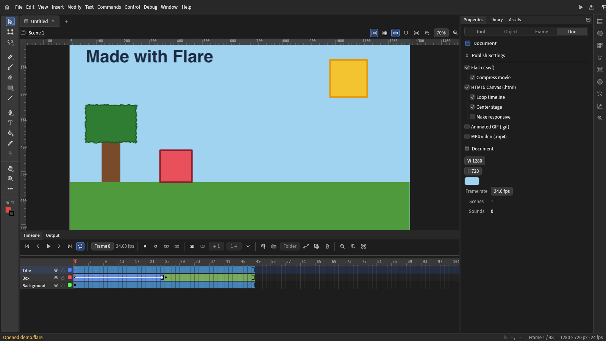
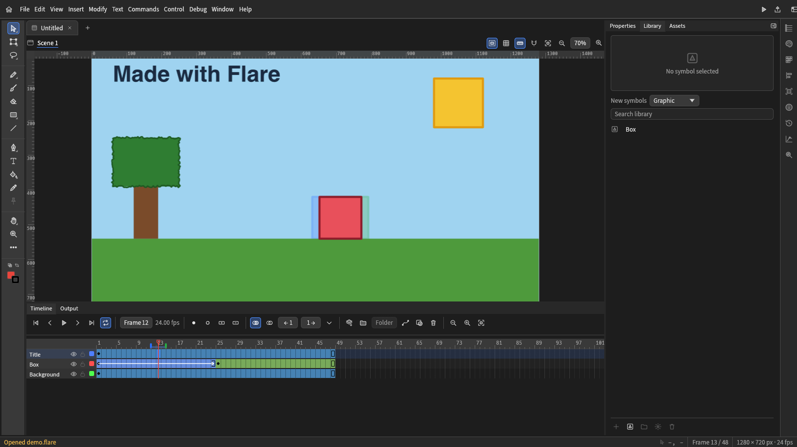

[English](../../README.md) | [Deutsch](README.de.md) | [Español](README.es.md) | [Français](README.fr.md) | **Italiano** | [Português (Brasil)](README.pt-BR.md) | [Čeština](README.cs.md) | [日本語](README.ja.md) | [한국어](README.ko.md) | [Русский](README.ru.md) | [简体中文](README.zh-CN.md)

# Flare

**Suite di animazione libera e open source con continuità per gli utenti di Adobe Animate e Flash.**

[Sito](https://flare-animate.github.io/website/) · [Versione web](https://flare-animate.github.io/Flare/) · [Discord](https://discord.com/invite/JpeScW8Awa) · [Compilazione](../BUILDING.md) · [Issues](https://github.com/Flare-Animate/Flare/issues)

> **Alpha iniziale.** Aspettati bug e una fedeltà incompleta nell'importazione di Flash/Animate. Fai il backup del tuo lavoro.

## Che cos'è Flare?

Flare, detto anche *FlareCraft*, è una suite di animazione in lavorazione (Work In Progress), pensata per rendere più facile il passaggio di artisti e animatori da software come *Adobe Animate*, *Adobe/Macromedia Flash* e *Moho*.

L'obiettivo è supportare i formati usati da questi strumenti, così che le persone possano aprire e continuare a lavorare sui file di progetto che già hanno, e disporre l'interfaccia in modo più semplice e familiare, personalizzabile.

Flare è riscritto in **Rust**. Si basa principalmente su *OpenToonz* e *Tahoma2D*, con funzionalità integrate da *AnimationCraft* e *Next2Flash*, assorbite in Flare. Il vecchio codice C++ è conservato come archivio in [`original/`](../../original/README.md).

## Schermate

L'editor con un progetto aperto: gli strumenti, lo stage, una linea temporale di tre livelli con un'interpolazione di movimento e le proprietà del documento.

A metà dell'interpolazione, con l'onion skin che mostra i fotogrammi vicini e il simbolo nella libreria.

Catturate nella versione per browser, che esegue lo stesso editor dell'app desktop.

## Funzionalità

- Disegno con penna, pennello e strumenti forma, con uno strumento di selezione per spostare, raggruppare e modificare le forme, e stili di tratto (continuo, tratteggiato, punteggiato, puntinato, tratteggio incrociato, irregolare, a spina di pesce, corda, zigzag).
- Una linea del tempo con fotogrammi, livelli, cartelle, maschere, guide di movimento, carta da lucido e un livello camera.
- Interpolazioni di movimento e di forma con accelerazione, e un Editor del movimento per le curve dei segmenti.
- Simboli (Grafica, Clip filmato e Pulsante) in una libreria, posizionati come istanze sulla scena.
- Impostazioni per le sessioni di stop motion. La cattura con la camera non è ancora pronta.
- Riproduzione audio su desktop e Filmato di prova, che esegue l'SWF pubblicato in Ruffle.
- Apertura e salvataggio di progetti `.flare`. Importazione ed esportazione di XFL e `.fla` di Animate, e apertura di filmati Flash (`.swf`) come progetti modificabili.
- Importazione di progetti Moho e movimenti BVH, scene `.tnz` e livelli `.pli` di OpenToonz, e opere e filmati (SVG, PNG, JPEG, GIF, WebP, PSD, MP4, MOV, AVI, MKV, WebM, MPEG, FLV) come progetti modificabili.
- Esportazione in PNG, JPEG, GIF, APNG, WebP animato, SVG, PSD, MP4 e MOV, altri formati video tramite ffmpeg, e pubblicazione di un SWF o di una pagina HTML5 Canvas.
- Una riga di comando (`flare`) e un server MCP (`flare-mcp`) per gli agenti, per creare, modificare, esportare e pubblicare progetti da script.
- Una versione per browser dello stesso editor. Vedi [docs/WEB.md](../WEB.md) per ciò che fa diversamente.

[docs/SURFACES.md](../SURFACES.md) elenca, funzione per funzione, cosa possono fare l'app desktop, la versione per browser, la riga di comando e il server MCP, e le lacune.

### Formati

- Flash/Animate: `.fla`, `.xfl`, `.swf` e `.fla` binario legacy (importato come scheletro). Salvataggio ed esportazione in `.fla`, `.xfl` e `.flare`.
- Moho: `.moho`, `.anime`, `.mohoproj`, `.animeproj` e movimenti BVH. Livelli, ossa, fotogrammi chiave e arte vettoriale si importano come progetti modificabili; immagini e suoni sono elencati, non posizionati.
- OpenToonz: si importano scene `.tnz` e livelli vettoriali `.pli` (frequenza fotogrammi, camera, colonne xsheet, tratti, colori della tavolozza). I livelli raster `.tlv` vengono rifiutati, e `.tzu` è previsto.
- Opere: SVG, PNG, APNG, JPEG, GIF, WebP, TIFF, BMP, TGA, ICO, QOI, PNM, HDR, OpenEXR, DDS e PSD si importano come livelli bitmap (GIF animata, APNG e WebP come animazioni); si esportano SVG e PSD. AVIF e HEIC non sono ancora supportati.

### Piattaforme

| Destinazione | Stato | Note |
|---|---|---|
| Windows (desktop) | Si compila dai sorgenti | Toolchain MSVC e `flare-desktop`. |
| Linux (desktop) | Si compila dai sorgenti | Servono le librerie elencate in [CONTRIBUTING.md](../../CONTRIBUTING.md). Il Filmato di prova richiede Ruffle compilato dal sottomodulo. |
| macOS (desktop) | Si compila dai sorgenti | Menu nativo. La pressione della penna arriva al Pennello. |
| Web (browser) | Attivo, in fase iniziale | La [versione web](https://flare-animate.github.io/Flare/) è distribuita da `main`. Niente esportazione MP4, niente audio, e il Filmato di prova gira nella pagina. |
| Android | Sperimentale | Prima build di `flare-android`, lo spazio di lavoro desktop in una activity nativa. I file non si possono ancora aprire o salvare tramite il selettore del telefono, e il Filmato di prova è disattivato. |
| ChromeOS | Non testato | La build Android produce APK per x86_64 e arm64 che dovrebbero funzionare lì. Su ChromeOS non è stato testato nulla. |
| iOS | Non compilato | Non esiste un'app iOS. Il job CI per iOS prova solo a compilare e non blocca. |

### Download

Non esiste ancora una versione stabile. Ogni notte una build di `main` viene pubblicata come pre-release, la [nightly](https://github.com/Flare-Animate/Flare/releases/tag/nightly): installer per Windows e zip portatili, immagini disco per macOS, pacchetti Linux `.deb`, `.rpm`, `.AppImage`, `.flatpak` e `.tar.gz`, archivi della riga di comando, APK per Android e la build per browser. La nightly viene ricompilata solo quando `main` ha nuovi commit, e conserva solo l'ultima build. I suoi pacchetti non sono firmati per la distribuzione; vedi [docs/RELEASE.md](../RELEASE.md). Per tutto il resto compila dai sorgenti (vedi sotto).

## Compilazione ed esecuzione

Rust è fissato in `rust-toolchain.toml`. Ruffle è un sottomodulo git, quindi clona con i sottomoduli:

    git clone --recurse-submodules https://github.com/Flare-Animate/Flare.git
    cd Flare
    cargo run --release -p flare-desktop

Su Linux installa le librerie elencate in [CONTRIBUTING.md](../../CONTRIBUTING.md).

[docs/BUILDING.md](../BUILDING.md) contiene i passaggi per ogni piattaforma: Linux, Windows, macOS, la build per browser e Android.

## Riga di comando

    flare new project.flare --width 1280 --height 720
    flare draw-rect project.flare --rect 100 100 300 200 --color FF6600
    flare export project.flare frame.png
    flare export project.flare loop.gif --format gif
    flare publish-html5 project.flare page.html
    flare --help

## Perché esiste Flare

Adobe ha [annunciato](https://community.adobe.com/announcements-539/adobe-animate-end-of-life-and-support-timeline-1548220) la fine del ciclo di vita di Animate e poi [ha cambiato rotta](https://community.adobe.com/announcements-539/update-on-the-status-of-adobe-animate-1548459). Il cambio di rotta non modifica quanto sia instabile il settore dell'animazione, né quanto una sola azienda ne controlli una parte. Gli animatori sono stati colti da un panico legittimo, e la carriera delle persone non dovrebbe dipendere dalla decisione di un'unica azienda di continuare a vendere un prodotto.

Flare è nato come un terreno di gioco per rendere l'animazione più facile da imparare, poi è stato reso open source e da lì è cresciuto.

## Roadmap

Le cose successive, dalla più importante. La maggior parte è mostrata in tono attenuato nell'interfaccia. [docs/ROADMAP.md](../ROADMAP.md) ripete questo elenco e prosegue con tutto ciò che ha priorità minore.

- Unione dei disegni: le forme a mappa planare di Flash, in cui le forme sovrapposte si tagliano e si fondono a vicenda (oggi le forme sono oggetti separati)
- Qualità del disegno: dinamica del pennello e tracciamento di una bitmap in forme vettoriali
- SWF che conserva più del documento: pulsanti con i loro stati, interpolazioni di forma come morph, maschere di più forme e suoni dentro i simboli
- Un Editor del movimento: grafici per proprietà e curve di accelerazione personalizzate per le interpolazioni
- Importazione di opere da file SVG e Photoshop
- Ossa dentro le forme e lo strumento Bind (sono già pronte le ossa che collegano le istanze di simbolo, posate con cinematica inversa con lo strumento Osso)
- Scorciatoie da tastiera modificabili

Pianificati anche, con priorità minore: ActionScript e un editor di script (l'ActionScript in un file importato viene conservato come dato e non viene mai eseguito), suggerimenti di forma e più di una scena, il resto degli strumenti di Animate, temi personalizzati, una barra degli strumenti completamente riordinabile e una versione web rilasciata.

## Documentazione

[docs/README.md](../README.md) spiega come è costruito Flare e dice cosa riguarda ciascun documento.

Chi contribuisce dovrebbe leggere [CONTRIBUTING.md](../../CONTRIBUTING.md), [AGENTS.md](../../AGENTS.md), [SECURITY.md](../../SECURITY.md) e [CHANGELOG.md](../../CHANGELOG.md).

## Il codice originale

[`original/`](../../original/README.md) è il codice C++ archiviato, basato su OpenToonz e Tahoma2D. Resta come semplice riferimento. Nulla in Flare dipende da esso o vi si collega. Dati e testi da esso ricavati vengono convertiti nei formati di Flare e attribuiti in [docs/ENGINEERING.md](../ENGINEERING.md).

## Riconoscimenti

Flare si appoggia a questi progetti. I loro avvisi di licenza sono conservati dove il codice è stato portato o usato.

- **OpenToonz** (BSD-3-Clause, Copyright (c) DWANGO Co., Ltd. and contributors): la base del codice originale. Il lettore PLI in `crates/io/flare-toonz` è portato da esso. I suoi file di traduzione sono stati il punto di partenza delle interfacce russa, ceca e italiana.
- **Tahoma2D** (BSD-3-Clause): un fork di OpenToonz e l'altra base del codice originale. Se ne sono lette la licenza e il README; i sorgenti degli strumenti sono stati solo confrontati.
- **AnimationCraft** (`MIT OR Apache-2.0`): il modello di authoring in Rust che Flare ha assorbito.
- **Next2Flash**: le sue parti MIT possono essere portate. Il suo worker FFDec è GPLv3, quindi si usa solo il comportamento.
- **jpdurigan/godot_moho_importer** (MIT, Copyright (c) 2022 Joao Pedro Durigan): la struttura delle mesh Moho usata da `crates/io/flare-moho`.
- **usvg** (MIT/Apache-2.0): il lettore SVG, usato come dipendenza.
- **Ruffle** (`third_party/ruffle`, un sottomodulo usato senza modifiche con la sua licenza): riproduzione Flash per il Filmato di prova e il crate `swf` per la pubblicazione di SWF.
- **ArtCraft** (`MIT OR Apache-2.0`) e **minnamate** (senza file di licenza, solo comportamento) sono fonti studiate. Le loro licenze sono elencate in [docs/BACKLOG.md](../BACKLOG.md).
- **nflare** e **FFDec** (GPLv3): solo comportamento, nessun codice. **SimplSam/moho-bvh-bones** (CC BY-NC-SA 4.0): non usato.

## Community

[Discord](https://discord.com/invite/JpeScW8Awa) · [Sito](https://flare-animate.github.io/website/) · [Discussioni](https://github.com/orgs/Flare-Animate/discussions) · [Issues](https://github.com/Flare-Animate/Flare/issues)

## Licenza

BSD 3-Clause. Vedi [LICENSE](../../LICENSE). I componenti di terze parti mantengono le proprie licenze.
