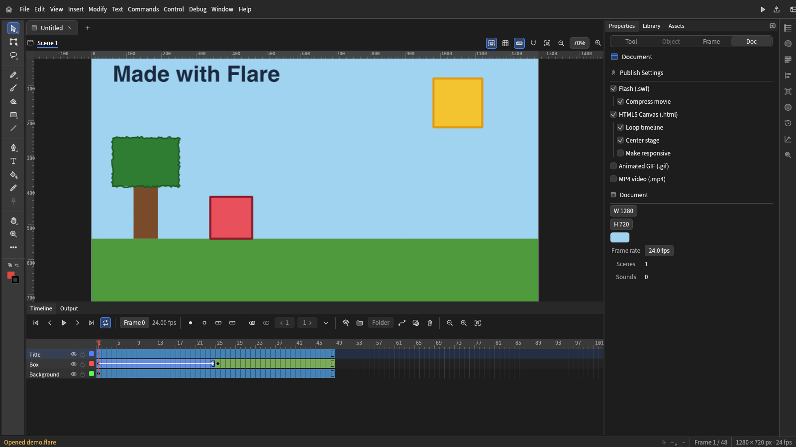
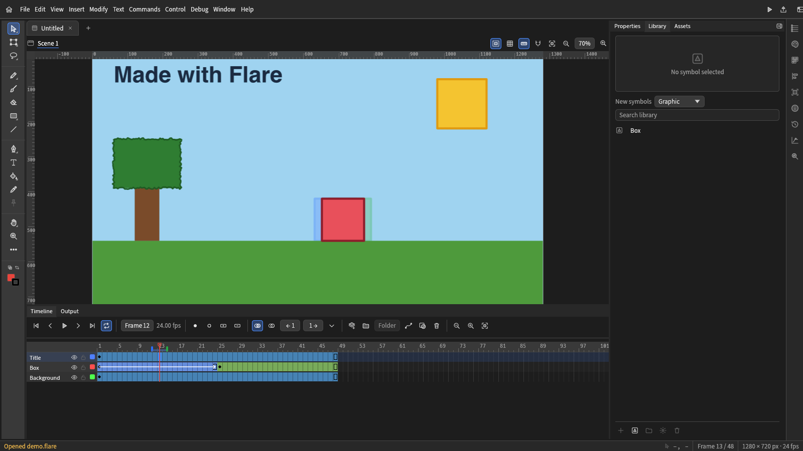

[English](../../README.md) | [Deutsch](README.de.md) | [Español](README.es.md) | [Français](README.fr.md) | [Italiano](README.it.md) | [Português (Brasil)](README.pt-BR.md) | [Čeština](README.cs.md) | **日本語** | [한국어](README.ko.md) | [Русский](README.ru.md) | [简体中文](README.zh-CN.md)

# Flare

**Adobe Animate と Flash のユーザーのための、継続性を重視した無料のオープンソースアニメーションスイート。**

[公式サイト](https://flare-animate.github.io/website/) · [Web版](https://flare-animate.github.io/Flare/) · [Discord](https://discord.com/invite/JpeScW8Awa) · [ビルド](../BUILDING.md) · [Issues](https://github.com/Flare-Animate/Flare/issues)

> **アーリーアルファ版です。** バグや、Flash/Animate からのインポートの不完全さがあることを前提にしてください。作業データはバックアップしてください。

## Flare とは

Flare は *FlareCraft* とも呼ばれる、(開発途中の) アニメーションスイートです。*Adobe Animate*、*Adobe/Macromedia Flash*、*Moho* などのソフトウェアから、アーティストやアニメーターが無理なく移行できるように設計されています。

これらのツールが使う形式に対応し、既存のプロジェクトファイルをそのまま開いて作業を続けられるようにすること、そして、より単純で馴染みのあるレイアウトで、好みに合わせて変更できる UI を提供することを目指しています。

Flare は **Rust** で書き直している最中です。主に *OpenToonz* と *Tahoma2D* を基にしており、*AnimationCraft* と *Next2Flash* から機能を取り込んで、Flare に統合しています。旧 C++ コードは [`original/`](../../original/README.md) にアーカイブとして残しています。

## スクリーンショット

プロジェクトを開いたエディター。ツール、ステージ、モーショントゥイーンを含む 3 つのレイヤーのタイムライン、ドキュメントのプロパティ。

トゥイーンの途中。オニオンスキンで前後のフレームが表示され、シンボルがライブラリにあります。

デスクトップアプリと同じエディターを動かすブラウザー版で撮影しました。

## 機能

- ペン、ブラシ、図形ツールによる描画。図形の移動、グループ化、編集のための選択ツールと、ストロークスタイル (実線、破線、点線、スティップル、斜線、ギザギザ、ヘリンボーン、ロープ、ジグザグ) があります。
- フレーム、レイヤー、フォルダー、マスク、モーションガイド、オニオンスキン、カメラレイヤーを備えたタイムライン。
- イージング付きのモーショントゥイーンとシェイプトゥイーン、およびセグメントのカーブを編集する Motion Editor。
- ライブラリに置かれ、ステージ上にインスタンスとして配置されるシンボル (グラフィック、ムービークリップ、ボタン)。
- ストップモーションのセッション設定。カメラでの取り込みはまだ実装されていません。
- デスクトップでのサウンド再生、および公開された SWF を Ruffle で実行する「ムービーをテスト」。
- `.flare` プロジェクトの開く・保存。Animate の XFL と `.fla` のインポート・エクスポート、Flash ムービー (`.swf`) を編集可能なプロジェクトとして開くこと。
- Moho プロジェクトと BVH モーション、OpenToonz の `.tnz` シーンと `.pli` レベル、そして素材と動画（SVG、PNG、JPEG、GIF、WebP、PSD、MP4、MOV、AVI、MKV、WebM、MPEG、FLV）を、編集可能なプロジェクトとしてインポート。
- PNG、JPEG、GIF、APNG、アニメーション WebP、SVG、PSD、MP4 のエクスポート（その他の動画形式は ffmpeg 経由）、SWF または HTML5 Canvas ページのパブリッシュ。
- スクリプトからプロジェクトを作成・編集・エクスポート・パブリッシュするためのコマンドライン (`flare`) と、エージェント向けの MCP サーバー (`flare-mcp`)。
- 同じエディターのブラウザ版。違いは [docs/WEB.md](../WEB.md) を参照してください。

[docs/SURFACES.md](../SURFACES.md) には、デスクトップアプリ、ブラウザ版、コマンドライン、MCP サーバーのそれぞれができることを機能ごとに一覧し、不足している点を示しています。

### 形式

- Flash/Animate: `.fla`、`.xfl`、`.swf`、旧形式のバイナリ `.fla` (骨組みとしてインポート)。`.fla`、`.xfl`、`.flare` への保存とエクスポート。
- Moho: `.moho`、`.anime`、`.mohoproj`、`.animeproj`、BVH モーション。レイヤー、ボーン、キーフレーム、ベクター素材は編集可能なプロジェクトとしてインポートされます。画像とサウンドは一覧表示のみで配置されません。
- OpenToonz: `.tnz` シーンと `.pli` ベクターレベルをインポート (フレームレート、カメラ、xsheet の列、ストローク、パレットの色)。`.tlv` ラスターレベルは拒否され、`.tzu` は計画中です。
- 素材: SVG、PNG、APNG、JPEG、GIF、WebP、TIFF、BMP、TGA、ICO、QOI、PNM、HDR、OpenEXR、DDS、PSD はビットマップレイヤーとしてインポートされます（アニメーション GIF、APNG、WebP はアニメーション）。SVG と PSD はエクスポートできます。AVIF と HEIC は未実装です。

### プラットフォーム

| 対象 | 状態 | 備考 |
|---|---|---|
| Windows (デスクトップ) | ソースからビルド可能 | MSVC ツールチェーンと `flare-desktop`。 |
| Linux (デスクトップ) | ソースからビルド可能 | [CONTRIBUTING.md](../../CONTRIBUTING.md) のライブラリが必要です。ムービーのテストには、サブモジュールからビルドした Ruffle が必要です。 |
| macOS (デスクトップ) | ソースからビルド可能 | ネイティブメニュー。ペンの筆圧はブラシに届きます。 |
| Web (ブラウザ) | 公開中、初期段階 | [Web版](https://flare-animate.github.io/Flare/) は `main` から公開されています。MP4 のエクスポートとサウンドはなく、ムービーのテストはページ内で動きます。 |
| Android | 実験的 | `flare-android` の最初のビルドで、ネイティブアクティビティ内でデスクトップのワークスペースを動かします。電話のファイルピッカーからの開く・保存はまだできず、ムービーのテストは無効です。 |
| ChromeOS | 未検証 | Android 版は x86_64 と arm64 の APK を作り、そこでも動くはずです。ChromeOS での検証はしていません。 |
| iOS | 未実装 | iOS アプリはありません。iOS の CI ジョブはコンパイルを試みるだけで、失敗しても止まりません。 |

### ダウンロード

安定版のリリースはまだありません。毎晩 `main` のビルドがプレリリースとして公開されます（[nightly リリース](https://github.com/Flare-Animate/Flare/releases/tag/nightly）。Windows のインストーラーとポータブルZIP、macOS のディスクイメージ、Linux の `.deb`、`.rpm`、`.AppImage`、`.flatpak`、`.tar.gz` パッケージ、コマンドラインのアーカイブ、Android の APK、ブラウザ版が含まれます。nightly は `main` に新しいコミットがあるときだけ再ビルドされ、最新のビルドのみを保持します。配布用には署名されていません（[docs/RELEASE.md](../RELEASE.md) を参照）。それ以外はソースからビルドしてください（下記）。

## ビルドと実行

Rust は `rust-toolchain.toml` で固定されています。Ruffle は git のサブモジュールなので、サブモジュールごとクローンしてください:

    git clone --recurse-submodules https://github.com/Flare-Animate/Flare.git
    cd Flare
    cargo run --release -p flare-desktop

Linux では [CONTRIBUTING.md](../../CONTRIBUTING.md) に記載のライブラリをインストールしてください。

各プラットフォーム (Linux、Windows、macOS、ブラウザ版、Android) の手順は [docs/BUILDING.md](../BUILDING.md) にあります。

## コマンドライン

    flare new project.flare --width 1280 --height 720
    flare draw-rect project.flare --rect 100 100 300 200 --color FF6600
    flare export project.flare frame.png
    flare export project.flare loop.gif --format gif
    flare publish-html5 project.flare page.html
    flare --help

## Flare が存在する理由

Adobe は Animate の提供終了を[発表し](https://community.adobe.com/announcements-539/adobe-animate-end-of-life-and-support-timeline-1548220)、その後[方針を撤回しました](https://community.adobe.com/announcements-539/update-on-the-status-of-adobe-animate-1548459)。撤回があっても、アニメーション業界がいかに不安定で、一社がどれほどの支配力を持っているかは変わりません。アニメーターたちは正当にパニックに陥りました。一つの製品を販売し続けるかどうかという一社の判断に、人のキャリアが左右されるべきではありません。

Flare は、アニメーションを学びやすくするための遊び場として始まりました。その後オープンソースとして公開され、そこから成長してきました。

## ロードマップ

次に取り組むことを、重要度の高い順に示します。その多くはインターフェースで淡色表示されています。[docs/ROADMAP.md](../ROADMAP.md) ではこの一覧を繰り返し、優先度の低い項目まで載せています。

- 描画の統合: 重なった図形が互いに切り抜かれて結合される Flash のプラナーマップ方式の図形 (現在、図形は別々のオブジェクトです)
- 描画品質: ブラシのダイナミクスと、ビットマップのベクター図形へのトレース
- ボタンの各状態、シェイプトゥイーンのモーフ化、複数図形のマスク、シンボル内のサウンドなど、ドキュメントをより多く保持する SWF
- Motion Editor: プロパティごとのグラフと、トゥイーンのカスタムイーズカーブ
- SVG や Photoshop ファイルからの素材のインポート
- シェイプ内のボーンとバインドツール(シンボルインスタンスをつなぎ、ボーンツールと逆運動学でポーズを付けるボーンは実装済み)
- 編集可能なキーボードショートカット

優先度の低いものとして、ActionScript とスクリプトエディター (インポートされたファイル内の ActionScript はデータとして保持され、実行されません)、シェイプヒントと複数シーン、Animate の残りのツール、カスタムテーマ、完全に並べ替え可能なツールバー、公開されたウェブ版も計画されています。

## ドキュメント

[docs/README.md](../README.md) では、Flare がどのように構築されているか、各ドキュメントが何を扱うかを説明しています。

コントリビューターは [CONTRIBUTING.md](../../CONTRIBUTING.md)、[AGENTS.md](../../AGENTS.md)、[SECURITY.md](../../SECURITY.md)、[CHANGELOG.md](../../CHANGELOG.md) を参照してください。

## 元のコードベース

[`original/`](../../original/README.md) は、OpenToonz と Tahoma2D に基づくアーカイブされた C++ コードベースです。参考資料としてのみ残しています。Flare は何にも依存せず、リンクもしていません。そこから取り込んだデータとテキストは Flare の形式に変換し、[docs/ENGINEERING.md](../ENGINEERING.md) に出典を記載しています。

## クレジット

Flare は次のプロジェクトの上に成り立っています。コードを移植・利用した箇所では、それぞれのライセンス表示を残しています。

- **OpenToonz** (BSD-3-Clause、Copyright (c) DWANGO Co., Ltd. および貢献者): 元のコードベースの基礎です。`crates/io/flare-toonz` の PLI リーダーはこれから移植しています。 その翻訳ファイルは、ロシア語・チェコ語・イタリア語インターフェースの出発点になっています。
- **Tahoma2D** (BSD-3-Clause): OpenToonz のフォークで、元のコードベースのもう一つの基礎です。ライセンスと README を読み、ツールのソースは比較のみに使いました。
- **AnimationCraft** (`MIT OR Apache-2.0`): Flare が取り込んだ Rust のオーサリングモデルです。
- **Next2Flash**: その MIT の部分は移植できます。FFDec ワーカーは GPLv3 のため、その動作のみを使用します。
- **jpdurigan/godot_moho_importer** (MIT、Copyright (c) 2022 Joao Pedro Durigan): `crates/io/flare-moho` が使う Moho のメッシュ構造です。
- **usvg** (MIT/Apache-2.0): SVG リーダーで、依存関係として使用しています。
- **Ruffle** (`third_party/ruffle`、改変せず独自のライセンスの下で使用するサブモジュール): ムービーのテストのための Flash 再生と、SWF パブリッシュのための `swf` クレート。
- **ArtCraft** (`MIT OR Apache-2.0`) と **minnamate** (ライセンスファイルなし、動作のみ): 調査した情報源です。ライセンスは [docs/BACKLOG.md](../BACKLOG.md) に記載しています。
- **nflare** と **FFDec** (GPLv3): 動作のみで、コードは使用しません。**SimplSam/moho-bvh-bones** (CC BY-NC-SA 4.0): 使用していません。

## コミュニティ

[Discord](https://discord.com/invite/JpeScW8Awa) · [公式サイト](https://flare-animate.github.io/website/) · [ディスカッション](https://github.com/orgs/Flare-Animate/discussions) · [Issues](https://github.com/Flare-Animate/Flare/issues)

## ライセンス

BSD 3-Clause。[LICENSE](../../LICENSE) を参照してください。サードパーティのコンポーネントは、それぞれのライセンスを保持します。
