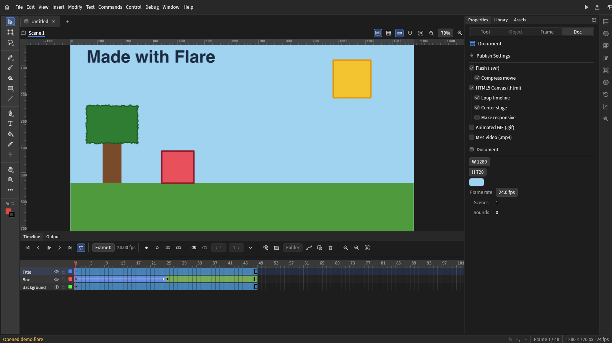
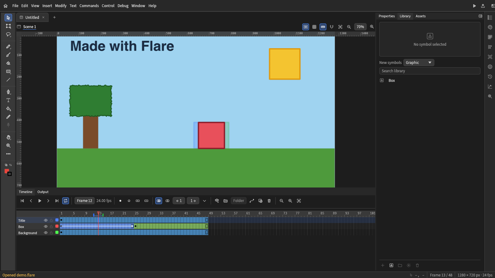

[English](../../README.md) | [Deutsch](README.de.md) | [Español](README.es.md) | [Français](README.fr.md) | [Italiano](README.it.md) | [Português (Brasil)](README.pt-BR.md) | [Čeština](README.cs.md) | [日本語](README.ja.md) | [한국어](README.ko.md) | [Русский](README.ru.md) | **简体中文**

# Flare

**面向 Adobe Animate 和 Flash 用户、保持工作连续性的免费开源动画套件。**

[官网](https://flare-animate.github.io/website/) · [网页版](https://flare-animate.github.io/Flare/) · [Discord](https://discord.com/invite/JpeScW8Awa) · [构建](../BUILDING.md) · [Issues](https://github.com/Flare-Animate/Flare/issues)

> **早期 Alpha。** 请预期会有错误，以及 Flash/Animate 导入不完整的问题。请备份您的作品。

## 什么是 Flare？

Flare，也称为 *FlareCraft*，是一个（开发中的）动画套件，旨在让艺术家和动画师更轻松地从 *Adobe Animate*、*Adobe/Macromedia Flash* 和 *Moho* 等软件迁移过来。

它的目标是支持这些工具使用的格式，让人们可以打开并继续处理自己已有的项目文件；同时采用更简洁、更熟悉的界面布局，并可按需自定义。

Flare 正在用 **Rust** 重写。它主要基于 *OpenToonz* 和 *Tahoma2D*，并吸收了 *AnimationCraft* 和 *Next2Flash* 的功能，这些功能已并入 Flare。旧的 C++ 代码作为归档保存在 [`original/`](../../original/README.md) 中。

## 截图

打开了一个项目的编辑器：工具、舞台、包含三个图层和一个动作补间的时间轴，以及文档属性。

补间进行到一半，洋葱皮显示前后的帧，元件位于库中。

截自浏览器版本，它运行的编辑器与桌面应用相同。

## 功能

- 使用钢笔、画笔和形状工具绘制，并提供用于移动、编组和编辑形状的选择工具，以及线条样式（实线、虚线、点线、点画、阴影线、毛边、人字纹、绳索、锯齿）。
- 带有帧、图层、文件夹、遮罩、运动引导线、洋葱皮和摄像机图层的时间轴。
- 带缓动的运动补间和形状补间，以及用于编辑补间曲线的 Motion Editor。
- 库中的元件（图形、影片剪辑和按钮），可作为实例放置在舞台上。
- 定格动画的会话设置。摄像头采集尚未实现。
- 桌面端的声音播放，以及在 Ruffle 中运行已发布 SWF 的“测试影片”。
- 打开和保存 `.flare` 项目。导入和导出 Animate 的 XFL 与 `.fla`，并可将 Flash 影片（`.swf`）作为可编辑项目打开。
- 导入 Moho 项目和 BVH 动作、OpenToonz 的 `.tnz` 场景和 `.pli` 关卡，以及图像和影片（SVG、PNG、JPEG、GIF、WebP、PSD、MP4、MOV、AVI、MKV、WebM、MPEG、FLV），作为可编辑的项目。
- 导出 PNG、JPEG、GIF、APNG、动画 WebP、SVG、PSD、MP4 和 MOV，其他影片格式通过 ffmpeg 导出，并发布 SWF 或 HTML5 Canvas 页面。
- 面向脚本的命令行（`flare`）和面向智能体的 MCP 服务器（`flare-mcp`），可通过脚本创建、编辑、导出和发布项目。
- 同一编辑器的浏览器版本。差异请参阅 [docs/WEB.md](../WEB.md)。

[docs/SURFACES.md](../SURFACES.md) 逐项列出了桌面应用、浏览器版本、命令行和 MCP 服务器各自能做什么，以及存在哪些缺口。

### 格式

- Flash/Animate：`.fla`、`.xfl`、`.swf`，以及旧版二进制 `.fla`（以骨架形式导入）。可保存和导出为 `.fla`、`.xfl` 和 `.flare`。
- Moho：`.moho`、`.anime`、`.mohoproj`、`.animeproj` 以及 BVH 动作。图层、骨骼、关键帧和矢量美术会作为可编辑项目导入；图像和声音仅列出，不会放置。
- OpenToonz：导入 `.tnz` 场景和 `.pli` 矢量级别（帧率、摄像机、xsheet 列、线条、调色板颜色）。`.tlv` 位图级别会被拒绝，`.tzu` 已列入计划。
- 素材：SVG、PNG、APNG、JPEG、GIF、WebP、TIFF、BMP、TGA、ICO、QOI、PNM、HDR、OpenEXR、DDS 和 PSD 会作为位图图层导入（动画 GIF、APNG 和 WebP 作为动画）；SVG 和 PSD 可以导出。AVIF 和 HEIC 尚未实现。

### 平台

| 目标 | 状态 | 说明 |
|---|---|---|
| Windows（桌面） | 可从源码构建 | MSVC 工具链和 `flare-desktop`。 |
| Linux（桌面） | 可从源码构建 | 需要 [CONTRIBUTING.md](../../CONTRIBUTING.md) 中列出的库。测试影片需要从子模块构建的 Ruffle。 |
| macOS（桌面） | 可从源码构建 | 原生菜单。触控笔压感可传递到画笔。 |
| Web（浏览器） | 已上线，早期 | [网页版](https://flare-animate.github.io/Flare/) 从 `main` 分支发布。没有 MP4 导出，没有声音，“测试影片”在页面内运行。 |
| Android | 实验性 | `flare-android` 的首个版本，在原生 Activity 中运行桌面工作区。目前还无法通过手机的文件选择器打开或保存文件，“测试影片”已关闭。 |
| ChromeOS | 未经测试 | Android 版本会生成 x86_64 和 arm64 的 APK，理论上可在其上运行。尚未在 ChromeOS 上测试。 |
| iOS | 未构建 | 没有 iOS 应用。iOS 的 CI 任务只尝试编译，失败也不会阻塞。 |

### 下载

目前还没有稳定版本。每晚都会把 `main` 的构建发布为预发布版本，即 [nightly 版本](https://github.com/Flare-Animate/Flare/releases/tag/nightly)：包括 Windows 安装程序和便携 ZIP、macOS 磁盘映像、Linux 的 `.deb`、`.rpm`、`.AppImage`、`.flatpak` 和 `.tar.gz` 包、命令行压缩包、Android APK 以及浏览器版本。只有 `main` 有新提交时才会重新构建 nightly，并且只保留最新的一次构建。这些包没有为分发签名，请先阅读 [docs/RELEASE.md](../RELEASE.md)。其他情况请从源码构建（见下文）。

## 构建与运行

Rust 版本固定在 `rust-toolchain.toml` 中。Ruffle 是 git 子模块，因此请连同子模块一起克隆：

    git clone --recurse-submodules https://github.com/Flare-Animate/Flare.git
    cd Flare
    cargo run --release -p flare-desktop

在 Linux 上，请安装 [CONTRIBUTING.md](../../CONTRIBUTING.md) 中列出的库。

各平台（Linux、Windows、macOS、浏览器版本和 Android）的步骤见 [docs/BUILDING.md](../BUILDING.md)。

## 命令行

    flare new project.flare --width 1280 --height 720
    flare draw-rect project.flare --rect 100 100 300 200 --color FF6600
    flare export project.flare frame.png
    flare export project.flare loop.gif --format gif
    flare publish-html5 project.flare page.html
    flare --help

## 为什么有 Flare

Adobe [宣布](https://community.adobe.com/announcements-539/adobe-animate-end-of-life-and-support-timeline-1548220)了 Animate 的停止支持，之后又[改变了决定](https://community.adobe.com/announcements-539/update-on-the-status-of-adobe-animate-1548459)。即便如此，这也说明动画行业何等不稳定，以及某家公司对它的控制有多大。动画师们陷入了恐慌，这种恐慌是合理的。一家公司是否继续销售某款产品，不应决定人们的职业前途。

Flare 最初是一个让动画更易于学习的试验场，后来开源，并由此不断成长。

## 路线图

下面是接下来要做的事情，按重要性排序。其中大部分在界面中以灰色显示。[docs/ROADMAP.md](../ROADMAP.md) 重复了这份列表，并继续列出所有较低优先级的事项。

- 绘图合并：Flash 的平面图形，重叠的形状会相互切割并合并（目前每个形状都是独立的对象）
- 绘图质量：画笔动态，以及将位图描摹为矢量形状
- 保留更多文档内容的 SWF：带有各状态的按钮、作为变形的形状补间、多形状遮罩，以及元件内的声音
- Motion Editor：按属性的曲线图，以及补间的自定义缓动曲线
- 从 SVG 和 Photoshop 文件导入美术素材
- 形状内的骨骼与绑定工具(连接元件实例、用骨骼工具通过反向动力学摆姿势的骨骼已完成)
- 可编辑的键盘快捷键

较低优先级的计划还包括：ActionScript 和脚本编辑器（导入文件中的 ActionScript 会作为数据保留，且从不执行）、形状提示和多场景、Animate 的其余工具、自定义主题、可完全重新排列的工具栏，以及正式发布的网页版。

## 文档

[docs/README.md](../README.md) 说明了 Flare 是如何构建的，以及每份文档涵盖的内容。

贡献者请阅读 [CONTRIBUTING.md](../../CONTRIBUTING.md)、[AGENTS.md](../../AGENTS.md)、[SECURITY.md](../../SECURITY.md) 和 [CHANGELOG.md](../../CHANGELOG.md)。

## 原始代码库

[`original/`](../../original/README.md) 是已归档的 C++ 代码库，基于 OpenToonz 和 Tahoma2D。它仅作为参考保留。Flare 不依赖它，也不链接它。从中取用的数据和文本会转换为 Flare 的格式，并在 [docs/ENGINEERING.md](../ENGINEERING.md) 中注明出处。

## 致谢

Flare 建立在以下项目之上。凡是移植或使用了代码的地方，都保留了其许可声明。

- **OpenToonz**（BSD-3-Clause，Copyright (c) DWANGO Co., Ltd. 及贡献者）：原始代码库的基础。`crates/io/flare-toonz` 中的 PLI 读取器即移植自它。 其翻译文件是俄语、捷克语和意大利语界面的起点。
- **Tahoma2D**（BSD-3-Clause）：OpenToonz 的分支，也是原始代码库的另一个基础。我们阅读了其许可证和 README；其工具源码仅作比较。
- **AnimationCraft**（`MIT OR Apache-2.0`）：Flare 吸收的 Rust 创作模型。
- **Next2Flash**：其中的 MIT 部分可以移植。其 FFDec 工作器采用 GPLv3，因此仅使用其行为。
- **jpdurigan/godot_moho_importer**（MIT，Copyright (c) 2022 Joao Pedro Durigan）：`crates/io/flare-moho` 所使用的 Moho 网格布局。
- **usvg**（MIT/Apache-2.0）：SVG 读取器，作为依赖使用。
- **Ruffle**（`third_party/ruffle`，以子模块形式未经修改地依其自身许可证使用）：用于“测试影片”的 Flash 播放，以及用于发布 SWF 的 `swf` crate。
- **ArtCraft**（`MIT OR Apache-2.0`）和 **minnamate**（无许可证文件，仅参考行为）：是经过研究的来源。其许可证列于 [docs/BACKLOG.md](../BACKLOG.md)。
- **nflare** 和 **FFDec**（GPLv3）：仅参考行为，不使用代码。**SimplSam/moho-bvh-bones**（CC BY-NC-SA 4.0）：未使用。

## 社区

[Discord](https://discord.com/invite/JpeScW8Awa) · [官网](https://flare-animate.github.io/website/) · [讨论区](https://github.com/orgs/Flare-Animate/discussions) · [Issues](https://github.com/Flare-Animate/Flare/issues)

## 许可证

BSD 3-Clause。见 [LICENSE](../../LICENSE)。第三方组件保留其各自的许可证。
